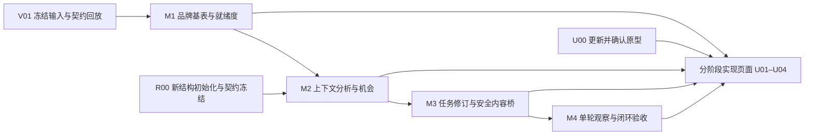

# 品牌可见性核心能力优化：可执行方案

日期：2026-10-24（Asia/Shanghai）
输入：[目标与落地复核](../reviews/citation-intelligence-value-review-20261024.md)。
状态：已获实施授权，v3 原型已由用户确认；R00 空库结构及跨服务回执验证完成，M1 正式页面在本地分支接入。分析接口余额恢复后已进行 8 例真实校准；发现的引用、来源质量及校验问题已修复，独立语义质量尚未验收。未部署生产。
任务清单：[22 项执行任务](citation-intelligence-value-tasks-20261024.json)。

**最新范围修订（2026-10-24）：用户再次明确平台未实际投产，不考虑迁移问题。按新数据结构与空库初始化设计，删除历史数据迁移、旧库升级适配、旧镜像数据库兼容及兼容前置发布工作。本文件此项约束覆盖此前方案中的迁移前置建议。**

## 1. 交付目标与范围

面向品牌负责人及内容团队，将现有采集和证据系统推进到以下实际结果：

> 针对某个问题/场景和大模型平台，说明我方与登记/未登记品牌的表现差异；给出可追溯依据、具体修改对象、真实材料需求、优先级和交付标准；在下一次单轮审计中观察对应变化。

保持已确认规则：

- 每题每平台默认采集一次；采集端策略由服务端管理，不要求客户选择或理解 APP/网页端。
- 四维评分继续使用出现 30%、推荐强度 30%、推荐位置 20%、选择理由 20%，版本仍为 `brand-visibility-v1`。不推断无序排名、不重分配未知项权重。
- 分析输入不按已登记品牌过滤；登记名单只决定重点和业务身份。未登记主体可发现、核实并比较，不自动登记为竞品。
- 回答表现、来源正文发现、事实核验、内容执行及效果判断分别建模。保存全文片段不等于文章完整，也不等于平台实际使用了该段。
- 不做历史数据迁移、旧库升级适配、旧版本数据库兼容、旧功能双轨或测试数据回填。近期一至两次材料可作为独立验收输入，不要求导入旧业务记录；新系统内分析仍采用不可变修订。
- 页面布局、控件和样式先更新原型、经用户确认后实现。以已确认 v2 为视觉基线，保留 v1/v2，新建本轮 v3 原型。

本轮不建设图数据库、新微服务、自动发布、全网竞品采集或多轮默认采集。不新增 PDF/OCR/视频等正文采集器；明确标注当前不支持项。设备网关不纳入默认发布范围。

## 2. 四个里程碑

| 里程碑 | 客户可感知结果 | 主要任务 | 放行条件 |
|---|---|---|---|
| M1 真实结果与评价就绪 | 真实材料能完成分析；品牌不消失；能知道分数为什么缺、如何补齐 | R00、V01、B01–B03、U00/U01，启动 Q01 | 系统性结构失败已消除；已知/未知不混用；问题/身份审核能形成新修订 |
| M2 场景与证据机会 | 看见竞品具体优势、我方资料缺口及应处理的资产 | A01–A05、U02，持续 Q01 | 每条机会有本平台证据、限制、我方材料状态及具体任务；来源洞察不依赖总分 |
| M3 行动进入真实执行 | 竞争机会可转核实任务、正式内容方案或人工任务，能修订和重批 | E01–E03、U03 | 至少一条真实竞争机会走完计划、事实批准、内容/人工交付；失效不形成死路 |
| M4 单轮观察与价值验收 | 发布后按同题同平台查看与行动目标有关的变化 | M01/M02、U04、Q02 | 一轮基线与一轮复测能得到有边界的描述结果；真实闭环可回查 |

U00 的原型可先覆盖四阶段关键流；后端及契约工作在获得实施授权后可并行推进。未经样式确认不实现相应 UI。任一阶段未通过验收，不以补图表或示例数据代替。



## 3. 总体实现方式

沿用现有 Portal、智见后端、ContentOS、MySQL、OSS 与持久队列，不建立平行的建议/行动系统。

1. **事实输入层**：冻结回答、引用观测、文章快照、问题版本、采集条件、项目品牌和我方资料版本。
2. **通用抽取层**：第一遍不提供品牌白名单，提取全部实体、观点、参数、案例、条件及限制；继续复用纯文本语义缓存。
3. **上下文分析层**：将同一份抽取放回原问题/场景/平台，识别选择条件、回答覆盖和品牌主张。按上下文版本缓存，不能把同段文字在不同问题中的含义混用。
4. **差距与机会层**：确定性逻辑计算分母和四维分数；使用已核实信息推导来源、事实和内容机会。事实、假设和未知分别保存。
5. **任务与执行层**：同资产同事实改动归并任务；我方已批准事实进入内容，竞品证据只解释诊断；版本变更后可重批。
6. **观察层**：保留逐平台、逐问题结果，比较行动目标维度；单轮变化不宣称统计显著或行动因果。

最小分析单元：`run × promptVersion × platform × brandTarget × scenario × informationUnit × evidenceVersion`。品牌角色不由模型写入，平台差异来自实际观测，不内置“某平台偏好某网站”的固定规则。

## 4. M1：真实结果、完整品牌基表、评价就绪

### V01 冻结近期真实输入，先解决系统性失败

- 工程/验收负责人整理最近一至两次材料，覆盖长回答、尾部段落、无品牌内容、未登记品牌、来源失败及同名歧义；冻结输入 hash 和 owner/offset。
- 从旧修订提取经过脱敏的结构失败案例，回放 `attributes list_type` 等契约问题。输出必须通过结构、主体、引用逐字和字符位置校验；允许的无损格式修正逐项定义，无法修正则失败并保留原因，不能随意补空数组制造成功。
- 本地确定性回放先行；真实模型验收在实施阶段使用现有受控配置与预算执行。保存新流水线版本、覆盖、预算和失败分布，不修改旧修订。
- 首次验收同时检查有效内容：不能仅以“JSON 能解析”判定分析有效。

### B01 目标品牌与观察实体分层

在 `run.manifest.brand_targets` 冻结“项目关注品牌 ∪ 全部发现实体”的映射，输出 `brand_presence`。

```text
BrandTarget: targetId, registryBrandId?, entityId?, role, identityState,
             namesAndAliases, contextVersion, mappingVersion
Presence: targetId, sampleId, platform, ownerKind,
          state=present|observed_absent|unknown,
          reasonCodes[], evidenceRefs[], coverageProof
```

- 没有出现的自有品牌仍有一行；这不是新增一条虚假实体提及。
- `observed_absent` 要求目标身份/别名范围可判断、回答完整、全文分析完成且无相关歧义；未完成保持未知。
- 仅来源中发现的主体不增加回答提及率。文章不完整时，只允许“保存文字中已观察到”，未命中不推定整篇缺席。
- 不相关主体的歧义只阻断有关品牌，不能让整条回答所有品牌一起未知。

### B02 评价就绪度与问题资格审核

复用已有 `evaluation-cohort` GET/review 接口和 `EvaluationCohortReview`。增加逐问题的原类别、建议场景、品牌定向判断、最终人工决定和理由；模型建议不能自动变成已审核结论。

`readiness` 分成 `capture / semantics / identity / prompt_scope / sources / scoring / insights`，每项返回 `state、completed/total、blockers[]、remedy、nextRunId?`。原因码至少区分：未采集、回答不完整、未分析、预算延后、身份待核实、问题待审核、无显式排序、事实冲突、来源完整性未知。

评分可缺、单维洞察仍可成立。无适用竞争问题是明确结果，不应显示为系统失败。审核后生成新修订并提示“新结果就绪”；不静默改变旧修订分母。

### B03 质量状态、预算和断点

- 区分取得正文、保存文字分析覆盖和原文章完整性。HTTP 200 或字数长不能直接判定全文完整。
- 对已验证的页面类型记录正文边界、截断/分页迹象、抽取器/校验版本；其他来源仍为 unknown。
- 总预算内分阶段预估、预留及结算：通用抽取、上下文分析、观点核验。优先保证回答基础分析，来源与核验都有明确预算，不让长文章静默耗尽全部资源。
- 每个非空片段要么完成、要么有待处理/失败原因和重试入口；缓存命中、技术重试、续做不重复计样本。复用现有租约、fencing 和检查点，不重写队列系统。

## 5. M2：将信息转成具体竞争机会

### A01 冻结业务场景

采用可扩展的固定场景字典：认知了解、方案/品类选型、功能比较、价格与成本、实施适配、案例与验证、风险限制、售后服务。一个问题可关联多个场景，但主场景用于预定聚合，不能把多标签重复计入分母。

保存问题意图、目标客户、使用情境、明确需求、约束及竞争资格。场景建议可审核，保留版本。问题预设品牌与中性选型分别呈现；不把问题中的品牌词带来的提及当自然发现。

业务重要性是独立的项目偏好，不是评分权重。由有权限成员在场景比较区设置低/中/高及理由，沿用项目配置版本和 outbox 同步，增加 `business_preferences` JSON。未设置时场景等权，明确显示“未设置业务偏好”，只按证据就绪、可控性和工作量作默认顺序。机会排序返回 `priorityPolicyVersion`；修改偏好可生成新的排序投影，但不改旧 Run 分数/分母，不触发采集或模型调用，批准任务保留其当时的优先依据。

### A02 信息单元与第二遍分析

新增 `ContextAnalysis`，以 run/owner/上下文 hash/分析版本持久化第二遍结果。第一遍缓存保持纯文本、无业务 owner；模型和上下文变化必须换签名。

信息单元至少覆盖：功能、参数、价格边界、客户/场景、实施条件、案例、测评方法、限制/风险、FAQ、比较关系和选择理由。每条包含主体、值/单位、限定条件、生效时间、原文位置、证据引用和审核状态。

先用规则规范名称、单位和维度；不能直接把互不相同的产品条件合并。第二遍输入冻结问题、已抽取单元及标注来源的我方材料，不能用我方宣传补写原回答。`need_matched` 必须说明匹配了问题中的哪个明确需求。

### A03 我方内容资产与事实输入

新增最小 `OwnedContentAsset` 版本记录，管理产品页、规格页、案例页、FAQ 和用户明确提供的资料。它与“发布后资产记录”不同，不能假定现有 `PublishedAsset` 已经覆盖审计前资产。

- 首批登记有限的具体 URL/资料，不进行全站无限爬取。公开 URL 复用现有安全抓取和 OSS 快照；资料进入本项目受控材料通道。
- 记录归属品牌、页面用途、版本、快照/文本 hash、材料状态和核实人；Run 冻结使用的资产版本。
- 自有资料是独立来源类型 `owned_asset`，不得伪装为平台实际引用或添加 CitationObservation。
- 对外可使用事实仍进入现有 `BrandFact` 审批，增加可辨别的来源引用类型，校验项目、归属、原文、范围及有效期。

R00 冻结 BrandFact 来源的联合类型：`citation_review` 使用现有 ClaimReview/ClaimEvidence/引用链，`owned_asset_revision` 使用同项目已核实的资产版本、快照/文字 hash、原文片段及材料核实记录。两条分支恰好一种有效，各自具备审核人与时间；调整现有必填引用关联为分支约束，不能给自有材料制造虚假 ClaimReview 或 CitationObservation。授权导出和 Brief v3 采用同一来源联合类型，验收必须覆盖“完全没有平台引用观测的自有材料，也能独立批准事实并进入合资格 Brief”。

由此区分：已有且清晰、已有但表达不清、真实材料未公开、材料尚未确认、确认不适用。不能从“资料缺失”推导“产品能力缺失”。

### A04 引用锚点及来源观察下钻

把已采集锚点冻结到 manifest。先按明确锚点关联回答观点与对应引用，再在同回答实际引用范围内召回正文段落；无锚点则标注推断关联方式。

候选预算与未检查范围显式返回，替换“只看固定五段且未命中容易被误读”的表现。关系继续区分支持、部分支持、矛盾、无法核验。

文章级归并下保留每条“平台 × 回答 × 引用类型 × 正文版本”观测；某平台实际引用与另一平台检索候选不能合成同一实际引用标签。保留内容重复族与独立来源数，不因转载重复给证据加权。

### A05 独立机会生成与排序

复用 `PlatformDiagnosis` 持久化机会，不另建平行建议库。六类诊断为场景覆盖、推荐竞争力、品牌认知、来源渠道、内容证据、平台差异。

- 四维单项差距仍可产生机会；正文中的案例、参数、冲突等也能独立产生核查任务，不要求先有完整总分或 10 分差距。
- 每条机会必须包含适用平台/问题、双方主体、观察事实、证据与反向证据、假设、未知、我方材料状态、建议任务和观察目标。
- `actionability` 分为 `ready_for_review / needs_material / needs_identity / insufficient_evidence / not_applicable`。待核实事项也可产生有价值的素材任务，不能伪装为可发布主张。
- 优先级先用透明的规则等级：事实纠错紧迫性、用户设置的场景重要性、证据准备度、覆盖范围、可控性与工作量；缺材料先进入准备队列。总分差只作一个输入，不输出 ROI 或成功概率。
- 同资产、同事实改动、同执行意图合并任务，保存所有平台子目标；冲突事实分开，不生成相互矛盾的品牌说法。

`TaskPack v2` 在 R00 冻结合同、A05 开始输出，E01 直接保存其不可变修订；不等到内容桥阶段重新变形。内容包括目标品牌/受众/问题、资产或新交付物、具体章节/提纲、渠道与理由、所需事实/材料、验收及平台子目标。稳定 `task_key` 由项目、目标品牌、资产/交付目标、事实改动及执行意图派生；平台/问题在子目标中归并而不丢失。新增子目标或修改材料/交付要求必须形成新修订，不可默改已批准任务。负责人、截止时间和执行进度独立记录，不属于事实审批签名载荷。

## 6. M3：具体任务、可修订审批与内容桥

### E01 版本和相关依赖

新增只追加的 `ActionPlanRevision`。`ActionPlan` 保留当前修订指针，审批绑定确切修订与依赖签名。

依赖包含实际引用的回答/正文、身份映射、目标问题、规则/模型解释版本及已选我方事实；不再因为新增无关事实、无关审核或较新的 Run 而让全部计划失效。

相关依赖变化后展示差异，创建新修订并重新审批。旧批准、旧 Brief 和旧发布记录仍能定位原版本；不能通过修改旧目标或覆盖审批快照“续签”。

### E02 竞争任务安全进入 Evidence Brief

消费 A05 已定义的 `TaskPack v2`，不在此阶段改写已有任务包。补齐材料就绪、事实绑定及内容消费合同。

竞争证据与我方可用事实分字段：前者解释诊断，后者来自身份和范围匹配、有效且批准的我方 BrandFact。两者可来自不同审计，但必须在当前审批时重新核对版本与有效期。

扩展为 `EvidenceBrief v3`：保存行动修订、任务包、多问题/多平台目标和上述两类证据；不得拼接多个问题制造一个 promptHash，也不静默截断目标。Visibility、Portal、ContentOS 的严格契约、签名、能力声明及测试一起更新。

ContentOS 仅使用我方批准事实创作。缺事实返回材料清单；身份/事实核查任务不能直接生成品牌宣传。现有支持的四个渠道继续生成待审草稿，官网/知乎/头条继续人工任务。无自动发布。

### E03 执行状态与责任

审批状态和执行状态分开。执行状态为 `not_started / preparing_materials / in_progress / delivered / accepted / cancelled`，保存负责人、截止时间、交付记录和外部工作流编号。

同任务能查看计划修订、素材、ContentOS/人工任务、交付和验收。生成成功不是发布；交付验收不是可见性提升。任务版本变化时不能把旧工作流产物自动归给新任务。

## 7. M4：单轮描述比较与行动验收

### M01 新增描述模式，保留统计门槛

复用现有 cohort/result，新增 `comparisonMode=descriptive_v1`。创建 cohort 时将 comparisonMode、metricVersion、brandTargetIds、目标问题/平台、评分规则与身份映射/条件策略版本冻结进 specification/hash，创建后不能切换模式，切换需创建新 cohort。结果去重和缓存包含该规范签名，避免同一对 Run 返回另一模式的缓存结果。旧的推断模式和 20 题×3 轮门槛保持独立，不通过放松门槛来制造效果结论。

- 一题一轮也能逐问题/平台查看前后品牌出现、推荐、明确位置、选择理由及来源事实；各值都能回到当次原文。
- 配对检查问题版本、平台、规则、身份映射和可获取的采集条件。分别返回 `comparable / conditions_unverified / incompatible / missing`。
- 只有该维度可比且双方已知时返回 `observed_delta`；条件未验证仍可并列展示事实，不能汇总成改善总分。不把缺失补零。
- 单轮描述不填推断模式的显著性和区间字段，不宣称稳定效果或因果；已知条件变化不能被忽略。

比较使用稳定 brandTargetId，而非只接受基线已经出现的 entityId。基线 entityId 为空但缺席判定成立、复测首次出现同一目标品牌时，也能展示描述结果；实体绑定变化需有同主体等价映射依据，不能静默把新主体当旧品牌。身份仍不明确或名字范围变化影响旧缺席判断时，保持不可判定或重新分析，不编造差值。

### M02 绑定行动、资产与时间

PublishedAsset 增加行动修订、Brief/草稿/人工任务编号及资产版本的关联。Cohort 冻结目标问题、平台和要验收的指标，Result 保存基线/复测 Run 与关联行动。

检查基线采样、发布、复测采样的先后次序。缺发布时间或时序不合格仍可查看两次观察，但不能显示为“该行动发布前后验收”。分别展示内容交付验收和可见性观察结果；保留每个平台的变化及退化。

## 8. 数据、接口和模块落点

### 持久化决定

| 数据 | 实现方式 |
|---|---|
| 目标品牌、场景、采集条件、材料版本 | Run.manifest 冻结；复用项目品牌/身份/问题审核记录 |
| 就绪度、品牌三态、矩阵和机会摘要 | Run.summary/coverage 投影；不让浏览器自行计算分母 |
| 场景业务偏好 | 项目配置新增 business_preferences JSON，经现有版本/outbox 同步；排序投影绑定具体版本，不改评分权重 |
| 上下文第二遍分析 | 新增 ContextAnalysis，项目/run/owner/上下文签名唯一；JSON 结果中每条信息单元有稳定 ID 和原文引用 |
| 我方资产版本 | 新增 OwnedContentAsset；正文仍复用文档/快照/OSS；与引用观测、发布记录区分 |
| 机会与任务 | 复用 PlatformDiagnosis、ActionPlan.target；新增 ActionPlanRevision 保存不可变修订 |
| 质量、依赖与发布关联 | 必要的可空/default JSON 元数据；SourceSnapshot 增加完整性证据，审批关联精确修订，PublishedAsset 增加 provenance |

本方案预期新增三张后端业务表，不新增 Portal 品牌主数据表或另一个事实库。Portal 项目配置和后端 ProjectContextEvent 增加业务偏好 JSON；BrandFact 按两种来源补字段和分支约束。具体 DDL 与索引在 R00 冻结，必须涵盖租户/项目复合约束、幂等、分页和并发修改验证。

### API 合同

以下是计划接口/增量，不代表已经实现。Portal 使用显式 BFF 代理和现有角色校验。

| 接口 | 变化 |
|---|---|
| GET /runs/{id} | 增加 readiness、brand_targets/brand_presence、场景及版本摘要；明细不塞全量正文 |
| 已有 evaluation-cohort GET/review | 接入客户操作，返回具体阻塞和生成的新修订信息 |
| 项目业务偏好配置接口 | 设置场景重要性/理由，角色校验和配置版本/outbox 同步；返回 priorityPolicyVersion |
| GET /runs/{id}/information-units | 新增按品牌/平台/场景/来源分页查询与原文定位 |
| /projects/{id}/owned-assets | 新增材料登记、版本查询、核实；后台安全补采，接口不信任客户端指定的快照归属 |
| GET /runs/{id}/opportunities | 从现有诊断投影筛选和分页，返回具体任务包、材料缺口和排序理由 |
| POST /actions/{id}/revisions | CAS + 幂等创建新修订，返回依赖变化；批准仍走现有审批机制 |
| GET /actions/{id}/brief-readiness | 返回合资格事实、排除理由、缺失材料、可执行模式与当前版本 |
| PATCH /actions/{id}/execution | 更新负责人/期限/交付状态，不允许以执行接口修改事实证据 |
| 已有 draft-approvals/brief | 支持经审核的竞争任务与 EvidenceBrief v3，能力不足时不发起额度预占 |
| 已有 cohort/results | cohort 冻结模式、指标版本、brandTargetIds 和比较范围；结果按规范签名去重，保存 action/asset/provenance，旧推断规则独立 |

权威结果仍由服务端重读。更改采用 expectedRevision/If-Match 与幂等键；viewer 只读，事实批准沿用有权限角色。原文和外链继续走项目校验、安全抓取、受控分页和证据有效性检查。

主要修改模块：

- 智见 `backend/app/intelligence/`：ingestion、semantics、pipeline、brand_evaluation、evaluation_reviews、evidence、sources、competitive_actions、diagnosis、actions、drafts、measurement、models；新增 contextual_analysis、information_units、owned_assets、opportunities 小模块。
- 门户 `src/components/visibility/`、`src/app/(dashboard)/intelligence/page.tsx`、`src/types/intelligence.ts` 和显式 integration BFF。
- ContentOS：现有 evidence-briefs 契约、能力声明、工作流和人工任务读写；不新增渠道生成器。

## 9. 原型与页面工作包

U00 在现有视觉体系上制作 v3：只调整受影响区域，不重新设计菜单或整站。确认稿、交互和截图通过显式 git 路径纳入 PR，不能再只存在被忽略的本地文件中。

| 页面 | 需确认与实现的变化 | 任务 |
|---|---|---|
| 审计洞察 | 本次结论、可评价范围、就绪原因、前三项机会和全部机会入口；数据不足时展示具体缺口 | U01/U02 |
| 品牌发现对比 | 关注品牌完整行、未登记品牌核实抽屉；已确认/待核实/未出现/未知；跨视图共用比较范围 | U01 |
| 平台差异对照 | 保持同一自有/对比品牌及场景；并列选择条件、证据与机会；设置场景重要性及查看排序理由，平台专项及共性任务分开 | U02 |
| 来源文章库/观点证据 | 文章展开到每次引用观测与对应版本；我方材料登记、取得/失败重试、版本核实和事实批准；观点与证据/冲突定位 | U02 |
| 优化行动/内容方案 | 具体任务包、材料就绪、负责人/期限、修订重批、自动带入合资格事实；直达交付记录 | U03 |
| 行动效果复测 | 一次采集、发起前可比性预检；行动发布与采样时间、逐平台观察变化和不可比原因 | U04 |

共同上下文放入 URL/页面状态：project、audit/run、ownTarget、compareTarget、platform、scenario、opportunity/action。不能切换 Tab 后静默换成第一个品牌。新修订中对象不存在时提示失效，不保留错误映射。

我方材料必须形成客户可完成的操作流：从机会的缺料项进入，登记具体 URL 或受支持的文字资料及品牌归属→查看取得状态/受限原因并按规则重试→核对保存版本和原文→提出并批准有范围、有效期的 BrandFact→提示后续分析修订使用的材料版本。未取得原文、无审核权限或不支持的文件格式必须给出可理解的阻塞；不得把“去补材料”链接到一个只有查询能力的空页面。U03 从批准事实选择返回原行动，保持修订和平台目标。

原型必须覆盖正常、加载、空、未知、部分完成、失败/重试、版本冲突、审批失效和无适用问题；桌面及手机验证下拉、Tab、按钮、抽屉、指针及键盘焦点。未改动模块无需重做。

## 10. 22 项执行任务与依赖

| ID | 执行责任 | 工作项 | 依赖 |
|---|---|---|---|
| R00 | 后端/数据契约 | 冻结最新结构与接口契约，提供空库初始化入口 | 无 |
| V01 | 后端/质量 | 近期真实输入冻结、旧结构失败与长尾内容回放 | 无 |
| B01 | 后端 | 目标品牌基表、缺席/未知/身份作用域 | V01 |
| B02 | 后端/门户 | 分层就绪度、问题资格审核及新修订契约 | B01 |
| B03 | 后端 | 来源质量证据、阶段预算及恢复 | V01；DDL 依 R00 |
| A01 | 分析/后端 | 业务场景分类、审核与固定聚合范围 | R00、B02 |
| A02 | 分析/后端 | 全量信息单元与 ContextAnalysis 第二遍 | R00、A01、B03 |
| A03 | 后端/门户 | 我方材料版本、快照与事实来源 | R00、B01 |
| A04 | 分析/后端 | 锚点优先核验、逐次来源观察与证据链 | A02、B03 |
| A05 | 分析/后端 | 六类机会、具体任务包与可解释排序 | A02、A03、A04 |
| E01 | 后端 | 行动不可变修订、相关依赖与重新审批 | R00、A05 |
| E02 | 三方集成 | 自有事实筛选、竞争 Brief v3 与 ContentOS | E01、A03 |
| E03 | 后端/门户 | 负责人、执行/交付状态与任务归并 | E01 |
| M01 | 后端 | 单轮描述模式与四维/证据配对 | B02、B01；可与 M3 并行 |
| M02 | 后端/门户 | 行动—发布资产—复测及时间验证 | E02、E03、M01 |
| U00 | 产品/设计 | v3 原型、关键状态及用户确认 | 以本方案为输入，可先行 |
| U01 | 门户 | 准备度、品牌核实抽屉、统一范围 | U00 已确认、B01/B02 |
| U02 | 门户 | 场景/来源/材料/机会下钻与深链 | U00 已确认、A03/A04/A05、U01 |
| U03 | 门户/ContentOS | 行动修订、材料就绪、内容与人工交付路径 | U00 已确认、E02/E03、U02 |
| U04 | 门户 | 一次观察预检、逐平台变化及局限 | U00 已确认、M02、U03 |
| Q01 | 质量/产品 | 分层真实标注集与每阶段人工质量验收 | V01 后持续开展 |
| Q02 | 全链路 | 真实任务到发布/单轮观察验收和分系统发布核验 | 各里程碑对应任务、Q01 |

执行状态保存在 JSON 清单；每项独立记录证据、提交/PR、测试、验收与原型版本。不因为代码合并自动标为真实业务已验收。

## 11. 验证和验收规则

工程强制用例：

- 未登记品牌、整批未出现的自有品牌、英文别名、同名不同主体、公司/产品不混算。
- 失败回答、长回答尾部、无品牌段落、来源卡片、正文受限/不完整、预算耗尽都保留状态。
- 无序推荐不生成名次；总分未知不重分权；同品牌同回答去重，来源出现不进入回答分母。
- 同段文本不同问题/材料版本不复用上下文解释；引用锚点串文、数字/日期/限定冲突能被定位。
- 正文独立机会可以在没有总分时成立；只有竞品事实时不能生成我方主张。
- 同事实同资产改动去重；相关变更失效、无关变更不失效；并发改版/审批拒绝旧版本；重试不重复扣额度。
- 一题×一次能看两边事实；不填统计结论；条件变化、缺样本/时间不明不宣称行动改善。
- 租户隔离、原文权限、外链安全、幂等、队列恢复及真实 MySQL 约束。

真实质量分三步：先冻结至少 20 条有代表性的候选用于人工校准；扩大至原方案约 100 组分层样本并留出独立集；按实体、证据支持、理由/排名和任务可执行性分别报告。数量是验证工作量，不是凑满即合格。关键证据错配、虚构事实和跨租户错误必须为零；语义准确性必须报告实际分子/分母，不预称达到 95%。

M2 的候选机会由品牌负责人逐条确认能否执行：目标、证据、我方材料、资产、任务和验收是否清晰。若样本确实没有高价值机会，报告无发现及覆盖，不凑三条；样本存在明确机会而系统遗漏则不得放行。

最终至少完成一条真实链：发现机会→确认身份/范围→计划批准→事实/材料批准→待审草稿或人工交付→真实发布登记→一次同题同平台观察。各阶段只证明对应事实，发布不等于改善。

## 12. 新结构初始化与交付顺序

按尚未投产的新系统实施，直接定义本轮所需的最新结构和接口，不安排兼容前置版本，也不把旧测试记录的可用性列为验收条件。R00 只承担必要的数据结构、约束、接口合同及空库初始化工作。

1. 本地明确 MySQL/PostgreSQL 的最新表结构、索引、项目隔离、幂等和联合类型约束；不要求通过旧结构升级到新结构。
2. 使用仓库现有 schema 管理工具提供可重复的空库初始化入口，验证新库中 API/worker 能启动、数据能正确读写。近期真实材料通过独立冻结样本用于测试，不搬迁旧业务库。
3. EvidenceBrief v3 按新契约统一联调；接收端能力就绪后再开放发送入口，未就绪不先扣内容额度。新系统内部仍保留行动、批准和产物的不可变版本关联，以保证后续业务可追溯。
4. 每个改变的系统独立 PR/CI。ContentOS 契约有变时先部署接收端，随后审计 API/worker，最后门户；不增加历史协议双轨，网关不随这些版本发布。
5. 门户本地按未变源码树执行一次 release:check，继续遵守现有权威 Actions、SHA 镜像与蓝绿发布流程；不在服务器开发或手工构建。
6. 各批按功能验收放行，部署后核对精确提交、API/worker、活跃槽、健康和资源；真实业务验收另有证据，不用健康检查替代。本次计划调整不执行数据库清空或重建。

**开始实施时的首批动作：** U00 更新可点击原型；V01 本地冻结与回放真实材料；R00 冻结新结构和接口并准备空库初始化。这三项可并行。原型确认后实现 U01，后端按上述依赖继续推进。未经新的执行指令，本方案不自动发起这些操作。


## 2026-10-24 后续实施记录

- 后端已完成独立最新空库基线及 MySQL/API/worker、PostgreSQL/outbox 到 MySQL 验签验证，见后端 `docs/citation-value-fresh-database-20261024.md`。不实施历史迁移。
- 真实模型校准已恢复：当前配置 3 条跨平台回答、5 段来源文字，8 次调用、27,584 token；结果及明确未通过的质量项见后端 `docs/citation-value-live-calibration-20261024.md`。这不是完整质量放行。
- 处理覆盖与局部证据拒绝分离；不可用正文保留原件并隔离；正文/压缩对象 hash 分别校验。B03 仍需阶段预算，M2 语境分析及 M3/M4 执行观察链路继续按台账实施。


### B03 分阶段预算实现补充

Run 冻结请求/token 总上限及阶段配额；回答按实际去重片段先预留，其余通用抽取额度用于来源，语境与核验预留不会被长正文透支。请求预留、实际/未知用量结算及中断恢复进入受 fencing 保护的账本，延后范围逐项返回。真实本地 MySQL/Pipeline 验证一条冻结回答实际结算 4,441 token；新修订复用缓存，新增调用和 token 均为 0。详情见后端 `docs/citation-value-budget-20261024.md`。A01 场景分类和 A02 语境分析仍待后续接入，预算预留不算作这两个任务已完成。


### A01 场景与审核接入

用户确认本轮新增审核/重要性控件：“认可，按此实现”。八类场景、问题审核证据和场景评分投影已接入，偏好通过门户项目锁及同事务 outbox 保存；场景选择保留在 URL，不将无场景数据回退为全审计分数。偏好暂提供配置与策略版本，A05 再消费排序，不改旧评分、不触发模型。详细技术及验收记录见后端 `docs/citation-value-scenarios-20261024.md`。A02 的角色/语境解释及完整执行闭环仍未完成。

### A02 本地实现进度（2026-10-24）

已接入十二类信息单元和持久化的第二遍语境分析，区分被比较方案、监测平台、来源与功能/品类。问题/平台/采集条件/人工需求及材料版本分别参与语境签名；第一遍纯文本缓存不含业务 owner，场景重要性变化不触发模型。需求匹配必须能同时定位本回答单元与已审核问题原文；业务身份和事实批准仍走服务端审核，不允许模型赋予。

真实冻结的豆包、Kimi 回答共 2,982 字符，经 4 次抽取和 4 次语境调用，保存 48 个有效单元与 4 份解释，实际 42,798 token。局部拒绝项仍有保留，Run 保持 partial；此计数不代表单元召回率、语义准确率或独立质量通过。新预算修订复用全部 4 份语境和抽取结果，新增调用/token 均为 0，旧 manifest 不变。完整记录见后端 `docs/citation-value-context-analysis-20261024.md`。

本轮无页面样式改动、无生产部署。A02 技术实现和 Q01 语义放行分别记录；A03 材料、A04 来源锚点、A05 机会/任务包以及执行/观察闭环继续按依赖推进。仍需代表性来源正文和独立金标/留出集，不以测试或 JSON 通过替代价值验收。


### A03 我方材料与事实接入（2026-10-25）

已实现自有品牌材料 URL/文字登记、固定审计参考用途、不可变版本与快照、取得状态和有限人工重试。审核先核对材料版本，再逐条批准具有逐字原文、适用范围和明确有效期的事实；无审计、发现实体或 CitationObservation 的材料也可经项目 API 独立批准，不伪造回答提及或提高可见性分数。品牌归属变化、材料换版/撤销核实、事实到期/撤回会退出可用范围，历史仍保留；Run 冻结版本，旧 manifest 不改写。

授权导出与新 Brief 合同共用两分支 FactSource。正式 Brief v3/ContentOS 发送仍属于 E02，当前 v2 明确拒绝自有事实；不把输入链路完成视为已完成创作闭环。门户按已确认 v3 接入“我方材料与事实”页签、登记弹窗和核实/事实抽屉，复用原有样式，无新布局方案。

最终后端全量 859 passed / 11 skipped，真实本地 MySQL 并发/旧快照审核与无审计事实证明 1 passed；门户新增代理/组件 10 passed，最终完整 release:check 通过。正式组件以虚构资料核对桌面及 390px iframe 窄屏；后者不是原生 viewport 测量。详见后端 `docs/citation-value-owned-materials-20261025.md`（提交 9635e37）和门户 `docs/reviews/citation-owned-materials-a03-20261025.md`。

本轮实际模型/生产/真实云对象写入均为 0。A03 记为技术完成；U02 仅材料子流程完成，仍待 A04 逐次来源锚点及 A05 机会/任务包。Q01 独立语义质量、Q02 真实价值闭环保持未验收，未上线部署。


### A04 引用锚点与来源观察（2026-10-25）

后端已冻结锚点 code point 范围、回答 hash 和正文版本，按明确锚点优先关联观点；没有锚点时明确披露同回答推断关联，检索候选不会当成实际引用。每观点候选配额、延后/无效及未检查正文范围分别记录，避免将没有检查当成原文不支持。

五维核验保留主体、范围、时间、数字及条件的逐字证据；明确冲突/部分支持不能被总体支持掩盖。同 Run 完全相同观点/正文复用核验而保留各引用记录。文章归并下继续保留平台×回答×引用类型×正文版本，完全重复与高度相似转载候选进入内容族，重复不累加，关系分歧不多数投票；独立发布方来源数保持未知。

新增具项目权限的只读分页 source-observations 接口和报告投影。最新空库结构增加证据核验 JSON 列，没有改旧库；独立本地 MySQL 实测落库/复用/旧租约拒绝通过。最终后端全量开启真实 MySQL 后 883 passed / 2 skipped；Ruff、compileall、离线源码 API/worker/storage/PDF 入口通过。技术记录见后端 `docs/citation-value-anchors-observations-20261025.md`（提交 3b33372）。

本轮没有页面样式/网关改动、真实模型/生产/OSS 写入或部署。现有网关默认不输出锚点，因此当前这类采集仍会如实显示回退；A04 记为后端技术完成，U02 页面下钻、A05 机会任务包及 Q01 独立语义验收继续保留。


### A05 证据驱动的具体任务包（2026-10-25）

后端已按六类机会消费稳定品牌目标、全部信息单元、上下文及来源核验，不再以总分完整或十分差距作为入口。自有品牌完全未出现、未登记品牌、没有品牌名的案例/参数等材料仍可形成有边界的核查与内容工作；未知不补零，缺料不推导能力缺失。

首次机会即输出严格 TaskPack v2，保留原问题、多平台/场景子目标、逐字证据与反向证据、实际材料版本或新交付物、目标客户状态、具体提纲/字段、渠道理由、材料需求和验收。相同改动归并而保留每条来源观察，冲突文字分开；定向排除范围单列，不进入可执行目标；超出合同容量明确阻塞，不截断目标。PlatformDiagnosis 和既有计划入口保存原包，旧诊断不可覆盖。

排序绑定偏好版本，按紧迫性、场景重要性、证据/材料准备度、覆盖及可控性等规则解释，未设置取中性50，不输出ROI或成功概率。只读接口显式 priority=current 可预览重排，不修改旧 Run/任务签名、不触发采集或模型。正式 Brief v3/ContentOS 仍待 E02，v2 拒绝新任务包以免丢失平台/问题目标。

最终后端全量开启真实 MySQL 为904 passed /2 skipped；专项20 passed，独立 MySQL 流水线到任务再到计划1 passed，Ruff/compileall/源码离线入口通过。详见后端 `docs/citation-value-opportunities-20261025.md`（提交3ce5350）。本轮无页面样式、网关或生产改动，真实模型调用与真实OSS写入均为0。A05按后端技术完成记录；U02页面、E01行动修订、E02创作、Q01独立语义/价值及Q02真实闭环仍未验收。


### E01 行动不可变修订与相关依赖（2026-10-25）

首次计划即生成不可变 ActionPlanRevision，当前指针、标题和目标投影与原版本逐次核对。具名批准绑定确切修订和依赖；修改交付、验收、自有事实选择或明确换用同任务的新诊断后，生成新版本、重新审批，不覆盖旧批准。

依赖范围缩至实际原文/反证、目标身份与注册映射/同名或绑定冲突、目标问题审核、来源版本/完整性/质量、相关人工审核、选中我方事实/材料和规则模型解释。新增无关事实/品牌、业务偏好、其他问题审核或较新的 Run 不自动撤销计划。相关变化返回前后值和原因，修订及历史 API 同时返回字段和依赖差异。

项目权限、具名操作者、严格 expectedRevision、幂等和 MySQL 当前锁定读均已验证：并发修改只允许一个新版本，相同请求只返回同一版本；等待项目锁期间提交的事实撤回可阻止审批。历史保留完整任务、所有平台子目标、原问题、批准与草稿所属版本；新版本批准不会让旧草稿复活。复用预留表，没有新增字段、迁移或改旧数据库。

最终后端开启真实 MySQL 全量 925 passed / 2 skipped；修订及证据审核专项30 passed；独立 MySQL 并发/撤回、A05 流水线和预算验证5 passed，Ruff/compileall/源码离线入口通过。技术记录见后端 `docs/citation-value-action-revisions-20261025.md`（提交2c0f424）。

本轮 E01 仅按后端技术完成记录。U02/U03 的任务详情、差异和修订审批页面、E02 正式 Brief v3/ContentOS、E03 执行交付、M01/M02 观察及 Q01/Q02 独立质量/真实价值闭环仍待继续。旧报表、事实批准和 Brief v2 的全局 stamp 不在本轮整体替换；新的任务包继续阻断 v2，不能冒充完整内容链路。没有页面样式、网关、真实模型/OSS、生产访问或部署改动。


### U02/U03 机会任务与行动修订页面接入（2026-10-25）

按已确认 v3 接入正式机会任务工作台，分层呈现观察、假设/未知、我方材料、具体交付、全部平台原问题和验收；保留未登记对象、准备队列、不适用范围和证据限制。任务范围与行动深链进入 URL，原文按真实 Run/owner/segment 及 Unicode 范围定位，不改写平台归属。

创建、具名批准、修改交付/提纲/验收、相关依赖差异、版本冲突和修订历史已接入 E01。结果不确定按原请求重试，成功保存后的读取失败不重复提交；新修订不继承旧批准。材料入口和返回保留原行动，旧建议页指向同一个完整工作台。

门户专项18项通过，完整 release:check 六项通过；客户端虚构任务包通过真实后端严格合同校验。实际组件以虚构资料检查桌面和真实390×844 viewport、创建/批准/修订/历史与原文定位，检查后恢复 viewport，截图与边界见 docs/reviews/citation-value-task-workspace-20261025.md。

U02/U03 保持进行中：来源逐次观察/锚点/版本/覆盖/内容族、概览和跨页统一范围、E02 合资格新事实及正式内容/人工任务、E03 执行交付及 Q01/Q02 真实质量/价值仍待完成。本轮没有修改后端/网关、生产读写、真实模型/OSS 调用或部署；没有把虚构组件检查称为真实业务联调。


### U02 来源逐次观察页面接入（2026-10-25）

按已确认 v3 接入文章归并表格与逐次观察抽屉，完整消费 A04 发布投影。同篇文章的每个平台/回答/引用类型/冻结正文版本分别回查；筛选在同一条观察上匹配，不借用其他平台的正文、实际引用标签或品牌提及。无文章标识时分别保留，不用相似标题/相同地址强合并。

精确锚点与同回答推测关联、原文版本校验、保存文字/原文章完整性、文本分析字符、五维观点核验及未检查范围、反证/同家族冲突与人工复核分层展示。正文发现的全部主体包括未登记品牌，但不冒充平台回答提及。相同/近似正文支持家族下钻，发布者独立性和原创性保持未知。核验摘录回到原 Run/snapshot/segment，按 Unicode 码点核对高亮；版本不符保留冻结摘录，不伪造定位。

专项36项通过；最终源码完整 release:check 六项通过。正式组件以虚构资料完成桌面及真实390×844视口检查，修复整页撑宽后复跑全量，恢复默认视口。截图、通过记录与边界见 docs/reviews/citation-value-source-observations-20261025.md。

U02仍在进行中：概览进入完整机会与跨页统一比较范围待完成；E02/E03、M01/M02/U04及Q01/Q02继续保留未完状态。本轮后端/网关/数据库未改，真实模型、生产访问、真实OSS、push/PR/部署均为0；组件样例不作为真实质量或业务闭环验收。


### U01/U02 统一比较范围与概览到机会/证据/任务（2026-10-25）

按已确认 v3 接入共同的自有品牌、对比对象、目标平台和场景控件，以 URL 保留跨页及刷新选择；失效对象保留并提示，不静默选择首个竞品。评分分项、同题平台和来源/观点按对应范围读取；身份发现、材料资产、已有内容/复测的全审计或冻结范围明确标记，不重绑定原证据。Run 以 URL 为优先依据，新修订保留范围并清除旧机会/行动，取消旧请求并防止重复发布回调清掉选择。

概览完整读取 A05 冻结/当前排序，展示本范围前三项及总数、材料准备和未知/延后状态，进入同一机会的完整任务或原始诊断/反向证据；不将不同子观察的平台、场景和比较对象拼成假匹配。证据按原 Run/owner/segment/Unicode 范围核对，失效 ID 不换用第一条，切换范围不改写引文；返回原范围只选择可确定的目标，不用第一个平台填空。

专项55项与最终完整release:check通过；正式页面组件以虚构只读数据和本地导航适配器检查桌面、390×844、刷新与新修订失效对象，视口已恢复，截图和通过记录见 docs/reviews/citation-value-shared-scope-20261025.md。根页面/导航适配检查不等于正式鉴权/后台服务全链路。U01/U02标记页面技术开发完成，状态仍进行中等待Q02真实路径统一验收。

下一阶段推进E02事实资格与Brief v3/ContentOS，再完成E03执行交付、M01/M02/U04发布后观察；Q01语义/任务价值与Q02真实客户闭环仍未验收。本轮未改后端/网关/数据库，无真实模型、OSS、生产访问、push/PR或部署。
