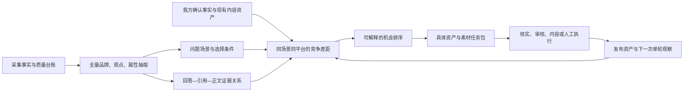

# 引用情报与品牌可见性：目标—落地—价值复核

日期：2026-10-24（Asia/Shanghai）
性质：现状复核与优化建议，不是实施批准；本轮未改业务代码、部署、启动采集或模型分析。
核实版本：门户 `dc8445f8373cb2c1c8ed72016d87d1d3cc751b3e`（0.5.0.1），审计后端 `2d66e9810f8d5522bc308f01b9526dbcf1c39c08`（1.2.0.0）。生产健康接口已确认。发布工作区与上述提交的相关业务源码一致；原始工作区中已有未提交改动均保留。

## 1. 判断

原方案方向仍然成立：利用平台回答、引用观测、文章正文和品牌事实，解释同一问题下不同品牌、不同平台的表现，形成有依据的行动并观察后续变化。无需重新搭建一套系统。

当前实现已经具备不少真实基础能力，但尚不能将“核心业务价值已交付”作为结论。主要问题有三层：

1. **真实结果验收不足**：当前客户打开的是旧流水线的失败分析修订，新版页面能显示，不代表新版语义和评分已用真实审计验收。
2. **信息提取多于差距推导**：正文、属性和观点已进入分析，但尚未充分转成具体场景、产品事实、内容资产和渠道的竞争诊断。
3. **执行和验证存在契约断点**：竞争行动能建计划，却不能进入正式内容 Brief；正常单轮采集与效果复测的硬门槛不一致。

建议下一阶段围绕“客户能选出并完成一件有证据的改进事项”验收，而不是继续以新增页面、图表或接口数量验收。

## 2. 线上实际样本

当前项目所选审计 #1、修订 5，完成于 10 月 18 日，早于 10 月 23 日评分版本发布。本轮生产数据库只读核实如下：

| 项目 | 实际值 | 应如何解读 |
|---|---:|---|
| 计划平台样本 | 5 | 实际取得 4 份回答，1 份失败 |
| 回答完整状态 | 4 份均为 partial/未确认完整 | 不能直接作为完整有效分母 |
| 来源观测 | 62 | 已关联正文快照 17；不是 17 篇已证明全文完整的文章 |
| 已登记分析片段 | 184 | 184 份均分析失败 |
| 语义分析字符 | 0 / 384,229 | 当前没有可验证的语义分析结果 |
| 抽取实体 / 观点 | 0 / 0 | 是未成功分析，不是没有品牌或观点 |
| 页面诊断 | 7 | 全为覆盖/采集问题：4 条 coverage_gap、3 条 capture_gap |
| 新评分字段 | 无 | 该修订没有 brand_evaluation |

记录中存在 `semantic_output_invalid`、实体 `attributes` 字段的 `list_type` 错误。这里证明的是旧修订失败及未重新生成结果，**不能据此断言当前发布代码重新分析后仍必然失败**。应先对真实输入做结构契约回放，再用新流水线产出一份新的有效修订验收。

10 月 23 日修复解决了缺少评分字段时隐藏新版布局的问题，未修改以上数据。不能把待分析雷达图当作完整业务验收。

## 3. 最初目标的落地情况

| 用户目标 | 已实现的基础 | 尚未交付充分的部分 |
|---|---|---|
| 尽量利用全部采集信息 | 回答、来源卡片、保存正文均分段分析；不限登记品牌；保留原文、位置和版本 | 真实成功覆盖未验收；属性、主题和引用锚点利用不足；大批次语义与观点核验共享预算 |
| 比较自有、竞品和未登记品牌 | 全量实体发现、人工消歧/别名/项目身份绑定；已确认未登记品牌可比较 | 完全未出现的登记品牌不会自动进入比较基表；客户缺少同屏身份核实材料 |
| 固定评价和明确结论 | 四维固定权重、分项/总分、固定问题范围、平台及类别切片 | 问题资格审核只有 API，没有客户入口；未知原因不清；严格排序条件使自然回答经常没有完整总分 |
| 理解不同平台差异 | 同题分平台回答、来源、分数、诊断与证据 | 问题类别未形成业务场景；属性/选择条件未形成系统性比较；跨视图品牌选择不连续 |
| 得到具体可落地建议 | 差距可投影为诊断、创建并审批计划；普通诊断已有内容/人工任务桥接 | 新竞争诊断被正式 Brief 拒绝；竞争任务多为固定模板，缺具体资产、选题、材料缺口和优先依据 |
| 验证自身品牌改善 | 固定队列、发布记录、复测及比较接口/页面存在 | 正常单轮基线达不到 20 题×3 轮硬门槛；只测提及类指标，尚未检验新建议承诺的推荐/理由/位置变化 |

因此应区分“代码能力存在”“接口接通”“客户可完成”“真实数据验证通过”四种交付状态。

## 4. 下一版核心分析逻辑

建议把最小分析单位固定为：**问题/场景 × 平台 × 品牌 × 信息单元 × 证据版本**。信息单元例如适用客户、产品能力、价格边界、实施条件、案例、限制、第三方验证。品牌名单用于关注与分类，不用于过滤输入。

通用第一遍继续不带品牌白名单；第二遍结合问题意图、我方已确认事实和内容资产判断具体差距。当前每块仅输入文本，`need_matched`只能表示片段内明确出现的需求，不能自动代表真正回答了用户提问。

### 4.1 保留四维评分，另建六类可解释诊断

四维评分回答“本次表现如何”，以下六类诊断回答“下一步做什么”。不强行把来源质量、事实正确性或流量合进一个总分。

| 诊断维度 | 固定观察项 | 客户得到的交付 |
|---|---|---|
| 场景覆盖 | 哪类中性选型问题提到谁；购买阶段/需求/限制覆盖；有品牌与无品牌回答 | 缺失的需求场景、应该覆盖的具体问题；样本不冒充市场搜索量 |
| 推荐竞争力 | 出现、明确推荐、显式位置、具体选择理由与顾虑 | 同题竞品优势片段与我方差距；保持现有评分规则版本 |
| 产品与品牌认知 | 能力/价格/适用边界/同名混淆/过时事实 | 需核实或纠正的断言及对应证明材料 |
| 来源与渠道 | 实际引用、候选来源、文章版本、重复内容族、品牌在正文中的位置 | 哪些文章/栏目值得核实、更新或提交真实资料；不把引用数当渠道 ROI |
| 内容与证据供给 | 参数、案例、方法、表格、FAQ、独立支持；我方资产的已有/缺失/未知 | 精确到页面及章节的补充清单，缺素材时先建核实任务 |
| 平台差异 | 相同问题/条件下的品牌、选择条件、证据和来源差异 | 共性任务、平台专项任务和待验证冲突；不预设平台固定偏好 |

**规则边界**：某维度未知仍保持未知；没有总分不等于不能发布证据充分的单维观察。源文未知不应封锁回答内已经成立的结论。单次审计提供本次样本结论，不声称稳定市场份额或模型内部原因。

### 4.2 将“回答表现”和“来源供给”交叉使用

| 回答中的品牌 | 已保存来源中的品牌 | 可提出的分析问题 |
|---|---|---|
| 出现 | 出现 | 哪些事实支持了这次回答？有哪些优势应保持或进一步核验？ |
| 未出现 | 出现 | 正文哪些品牌信息没有体现在本次回答？相关段落是否真正匹配问题？只能提出候选解释。 |
| 未出现 | 未发现/未知 | 是我方资料在这组来源中缺席，还是正文不全/未分析？需要哪些自有资产核查？ |
| 出现 | 未发现/未知 | 回答中的断言是否有可核实依据？是否需要纠错或补真实证明？ |

仅在完整性足够且完成分析时才使用“未出现”；其他情况为未知。平台没有引用某文章不代表从未检索过。缺少我方公开材料也不等于我方没有该能力。

## 5. 需要优先修正的业务断点

### P0：让客户获得可信的真实结果

1. **完成一份新流水线真实审计验收。** 使用近期材料或新单轮审计；先回放结构契约与错误处理，再验证来源/回答/片段覆盖、实体、观点、分项、差距和至少一条可执行任务。不需要迁移大量历史测试数据。
2. **补齐评分前置条件的客户入口。** 展示问题纳入/排除/待审核、身份缺失、失败样本、无显式排序、证据冲突等原因，并给对应修复入口。默认一次采集不变。身份和问题审核需要产生新修订，界面应能明确跳转查看。
3. **建立品牌比较基表。** 登记/关注主体与实际观察实体分层连接。自有品牌整批没出现时仍有一行；分析完整可判该样本未提及，分析失败则未知。不得伪造实体提及。未登记品牌可先作为观察对象，确认后比较，无须自动登记或消耗品牌名额。
4. **拆开完成度。** 分别显示采集完整度、语义分析覆盖、来源取得/全文质量和评分就绪度。当前有来源的 Run 被强制标 partial；该状态本身并不禁止所有分数和诊断，但容易掩盖具体成功/失败原因。

验收：一份真实结果能明确回答“当前能判断什么、不能判断什么、为何不能、下一步如何补齐”，而不是长期显示空图和零实体。

### P1：让已采集正文产出具体竞争机会

1. 归一化场景、选择条件、品牌属性、主张、数值/单位/限定、时间和材料类型；形成品牌×场景×平台的信息矩阵。
2. 将已保存引用锚点纳入对齐；精确标记优先，其次同回答实际引用，再做段落召回和关系核验。未命中的候选保持未知；不能将当前 top-5 候选之外的证据解释为不存在。
3. 正文洞察可独立产生，不依赖先有四维分差。即使问题审核或排序维度未就绪，仍可输出“已核实的产品事实冲突”“文章含竞品案例、我方材料待核查”等任务。
4. 衔接我方官网/知识材料/现有内容清单，区分已有但表达不清、已有但未公开、材料未知、真实能力不具备。只有这样才可决定更新旧页、新建内容、补素材或纠错。
5. 按问题业务重要性、证据充分度、覆盖范围、可控性和预计工作量排序。分差阈值只用于筛选，不当作商业优先级、统计显著性或成功概率。

验收：客户可以从一条差距定位到竞品证据、我方待核实材料、应修改的资产及具体章节。不能只生成“增加优质内容”“多渠道发布”。

### P1：竞争行动进入真实执行

1. 扩展竞争诊断到内容方案的明确契约。当前不仅有诊断类型限制，还缺少正式 Brief 所需的来源/目标问题关联；不能仅放开类型名单。
2. 竞争证据证明“对手被怎样描述”，我方已确认事实才可作为“我方可以怎样写”的依据。素材不足先创建核实任务，不绕过审核。
3. 保留行动历史，提供失效行动的新修订及重新审批；相关证据变化才失效，避免任意项目事实复核令所有计划失效且无法重新批准。
4. 一个资产改动可挂多平台目标；同事实同资产任务归并，冲突事实不合并。补实际负责人、截止日期和待核实/计划/执行/交付/验收状态。
5. 跨视图保持自有/对比品牌、平台、问题、差距、证据和行动上下文。概览应直接进入对应行动或原文，而非要求客户重新搜索。

任务包最低字段：目标平台与问题、观察事实、竞争对照、诊断假设、我方真实材料、具体资产/章节、操作步骤、负责人/工作量、交付验收、下一次观察指标。

### P2：单轮复测真正有用，同时保持结论边界

现有后端要求至少 20 个共同问题、每题 3 个共同轮次才输出有效比较；基线来自一个审计，只比较一对 Run，没有跨审计累积机制。普通单轮基线因而无法达标。多次点击当前复测也不会把轮次累计成 3。

建议维持用户每次只采一次的要求，分开提供：

- **普通复测**：同题同平台逐项展示本次与上次的出现、推荐、理由、明确位置、来源与事实变化，显示共同样本、失败、不可比条件。这是描述性变化，不证明稳定效果或因果；条件不可比时不汇总改善分数。
- **长期效果评估**：以后在单独授权和足够独立审计基础上提供，采用经校准的样本/不确定性规则。现在不应恢复三轮默认值，也不应为显示结果偷偷降低置信门槛。

复测要关联具体行动、资产版本和发布时间，并检验该行动原先的目标。当前只测提及类指标，不能完整验收“推荐理由/排名改善”建议。

## 6. 一张高价值机会卡应是什么样

以下为**格式示例、虚构情境**，不是当前项目的真实诊断：

> **优先事项：补齐连锁门店场景的实施证据。**
>
> 本次某平台的“连锁门店如何选工具”回答明确推荐 B，理由包含跨门店权限与实施案例；我方 A 未被推荐。证据链接分别指向回答片段和文章段落。
>
> 我方已确认的产品资料支持跨门店权限，但现有产品页未解释权限边界；实施案例尚待业务负责人提供。这里证明的是资料差距，不能直接证明未被推荐的原因。
>
> 执行：更新产品页权限章节，补一张角色/权限表；取得经核实的客户案例后补充实施过程与适用限制。先交素材核实任务，资料批准后生成正式内容方案。
>
> 验收：事实与证明一致、页面可访问、章节完整；下一次单轮审计沿用相同问题和平台，分别观察品牌是否出现、是否推荐、是否给出相应理由。其他平台同步观察，避免整体均分遮住单平台退化。

真正的核心能力在于稳定地产出这种有证据、有限定、可执行、可验证的事项，而不在于把同一批数据换成更多图表。

## 7. 验收与推进建议

| 顺序 | 要交付的结果 | 放行条件 |
|---|---|---|
| 第一批：真实结果与就绪引导 | 新分析结果、品牌基表、问题/身份审核、分层覆盖 | 已知/未知原因准确；真实人工核对通过；不会把未分析标成品牌缺席 |
| 第二批：场景与证据机会 | 六类诊断中的具体内容/事实/来源差距、排序和任务包 | 人工确认一批证据关系与建议；品牌负责人可选出至少 3 条具体任务，不能为凑数捏造结论 |
| 第三批：执行贯通 | 竞争计划→核实事实→内容或人工任务→发布资产 | 至少完成一条真实链路，失效/修订/重批可正常处理 |
| 第四批：单轮描述复测 | 行动目标逐平台前后变化 | 相同问题条件、完整分母、不可比项和局限可见；不以单次变化宣称因果 |

已有质量导出/标注工具可以复用。先做真实人工复核，再扩大留出集，分别检查实体准确性、观点与证据关系、理由/排序判定、建议可执行性及各平台分层。单元测试通过不等同于语义质量或客户价值验证。

涉及页面样式、控件或布局的实现，继续遵守用户要求：先更新已确认原型并确认，再改业务页面。本报告不代替原型确认，也不授权生产重分析或发布。

## 8. 核心依据与可追溯位置

- 原始目标：[从可见性审计到品牌增长证据系统](../designs/citation-intelligence-and-brand-growth.md)，尤其 §5、§8、§9；固定评价增量：[实施计划](../audit-evaluation-implementation-plan.md)。
- 全量分段与结果投影：`E:/workspace/.release-audit-backend/backend/app/intelligence/pipeline.py:238,346,586,669,733`。
- 语义范围、上下文与结构：`backend/app/intelligence/semantics.py:159,207`；正文完整性：`sources.py:192`；锚点：`ingestion.py:307,328`；观点候选：`evidence.py:119-145`。
- 固定评分与问题资格：`brand_evaluation.py:30,157,230`；显式排名：`brand_ranking.py:7`；分项竞争差距与固定任务：`competitive_comparison.py:36,138,164,209`。
- 来源任务依赖差距：`competitive_actions.py:14,39`；正式 Brief 类型限制与前置：`drafts.py:214-220,252-255`；计划失效/审批：`actions.py:71,140,238,275`。
- 复测硬门槛与比较：`measurement.py:39,162,285,549-603,745`。
- 门户评分审核代理：`E:/workspace/.release-audit-portal/src/app/api/integration/intelligence/route.ts:80,99`；评分界面：`src/components/visibility/brand-score-workspace.tsx:25,38,63,68`；来源观测聚合：`citation-prototype-views.tsx:167,223`；真实页面挂载：`src/app/(dashboard)/intelligence/page.tsx:194-246`。

### 外部依据的适用范围

[Google 官方生成式搜索指南](https://developers.google.com/search/docs/fundamentals/ai-optimization-guide)强调有价值、可靠且可访问的内容与现有 SEO 基础，并不保证索引或呈现。它支持将建议落到真实内容资产及技术可发现性，但只能用于 Google 的适用范围，不能外推为千问、豆包等平台的内部算法。

[Bing 官方 Topics Portfolio 说明](https://blogs.bing.com/webmaster/2026/10/introducing-topics-portfolio-beta-in-ai-performance/)将已出现与其他站点出现、自己未出现的查询按主题组织，也明确分类和数值有局限。可借鉴“主题—具体问题—竞争机会”的信息组织；本平台采集样本不等于 Bing 的真实检索需求数据，不能借此计算市场需求量。
