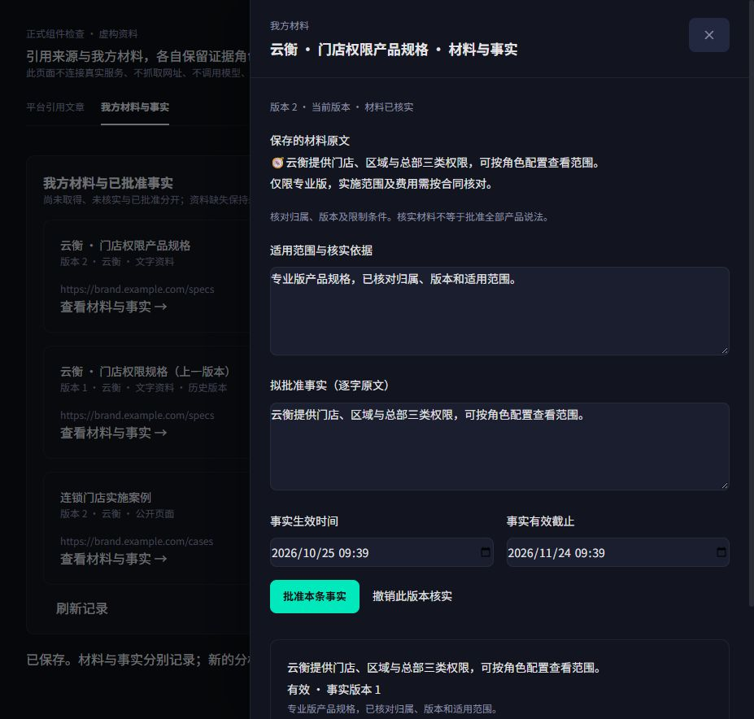
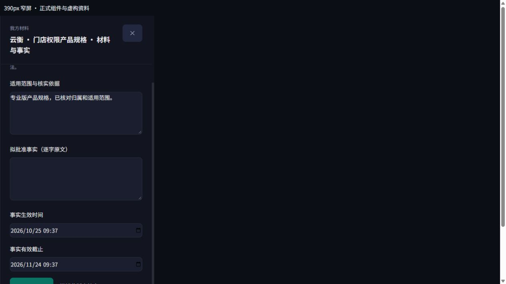

# A03 正式组件接入检查（2026-10-25）

本地实现了已确认 v3 的“平台引用文章 / 我方材料与事实”分流、材料登记/新版本弹窗、原文抽屉、独立核实与事实审批/撤回。使用现有样式和控件，未引入新导航或重做 CSS。登记用途固定为审计参考；URL 与文字同时填写时保存文字、保留 URL 参考。

门户代理严格限制项目、角色、操作字段和路径，并在变更前交付当前服务端品牌登记。材料状态每 5 秒按需刷新；未知写入保留原幂等载荷，已成功写入后的刷新失败单独提示。事实按同一逻辑材料读取历史，避免其他材料的同文事实污染版本判断。

## 验证

- 新增 API 代理与 React 组件测试共 **10 passed**。
- 最终源码 `npm run release:check` 全通过：dependencies、Prisma、types、lint、全量 tests、build。日志 `E:/workspace/.citation-value-db/owned-portal-complete.log`。
- 正式 `OwnedMaterials` / `SourceLibrary` 组件配合本地虚构 fetch 数据做可点击检查：材料核实 → 指定原文 → 明确有效期 → 保存有效事实。未连接真实后端、未采集网页、未调用模型。
- 桌面检查可见抽屉和操作层次；页面 DOM 宽度/滚动宽度均为 927px，审批按钮指针为 pointer。原生 textarea rows 保证长文和依据可读，不依赖被全局 unlayered min-height 覆盖的工具类。
- 390px **iframe** 窄屏检查可见字段在容器内、日期纵向排列、抽屉可滚动。本轮不是浏览器 viewport 模拟，不能据此宣称完成原生手机/内部文档横向溢出的自动测量。

截图中的“云衡”及文字均为虚构测试材料。Standalone 检查壳仅替换 Next Link 的路由外壳并使用当前构建 CSS；业务控件为正式组件。临时页已关闭，未改用户原有页面。

## 仍待后续任务

U02 只完成我方材料子流程。逐次平台引用/正文版本、锚点与冲突下钻、机会到行动深链仍依赖 A04/A05。自有事实来源导出已可用，正式 Brief v3/ContentOS 创作仍待 E02；不把该事实批准视为整套价值闭环已交付。本次未上线部署。
