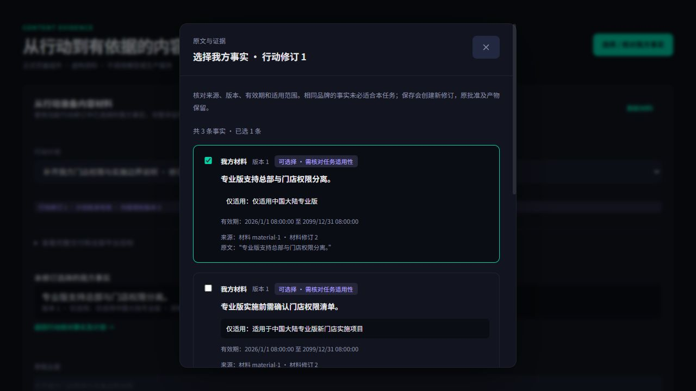
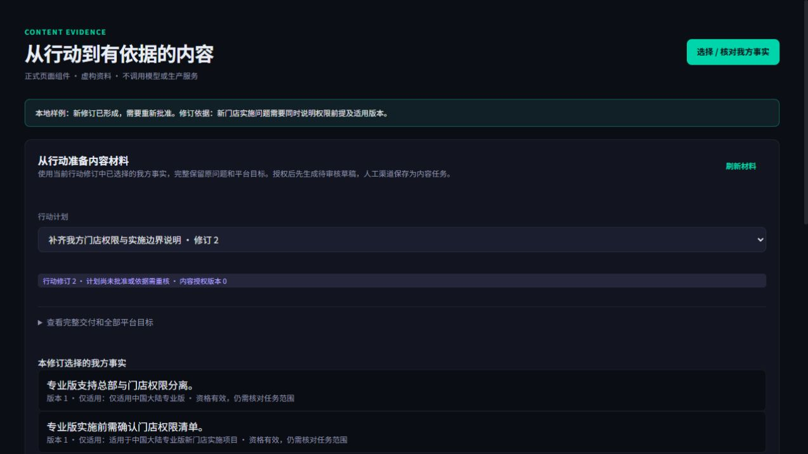
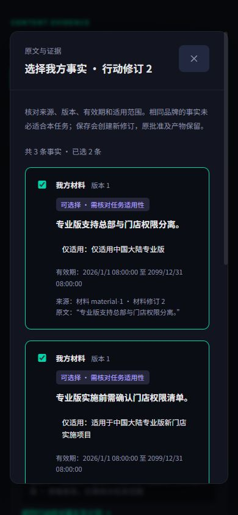

# E02：事实选择与内容材料 v3（2026-10-26）

用户已确认局部原型 `docs/prototypes/citation-facts-v3/index.html`，回复“认可，按此实现”。本轮据此接入正式组件；沿用现有 TaskWorkspace、ReadingDrawer、表单及平台图标。尚未发布。

## 已实现的路径

1. 在具体行动中打开“选择 / 核对我方事实”。后端使用共同资格规则，列表、行动依赖和内容授权使用同一事实状态；核对自有品牌归属、来源、具名审核、最新版本、有效期及材料状态。返回当前行动修订及完整清单的投影哈希。只读查询不创建审批或采集任务。
2. 抽屉完整读取所有分页，拒绝混合版本、重复记录、断页、错误行动或品牌范围。展示来源、版本、期限、范围与原文；新候选不自动勾选，失效原选项可以移除。相同品牌不等于适用于本任务，需要明确范围复核及理由。
3. 保存走既有不可变行动修订接口，完整保留 TaskPack 中的原问题、平台/场景目标及诊断依据。原批准不继承，新修订重新审核。保存结果不确定时锁定编辑并重试完全相同的请求和操作编号；冲突后要求重读。
4. 内容材料页读取确切行动及其事实，自动获取最新授权版本，不要求手填版本或重新任意挑选事实。具名内容审批独立确认任务范围、渠道和期限；期限受事实有效期约束。Backend 导出单一 EvidenceBrief v3，保存完整任务、行动签名、原问题和观测条件；不静默截断。
5. ContentOS 使用独立的我方事实生成允许陈述与参考资料。竞品观察、假设、未知和反证保留为诊断字段，不能变成我方主张。四个已实现渠道生成待审草稿，官网/知乎/头条保存人工任务。读取材料、生成前及人工任务推进时仍复验实时授权。
6. 服务端在预占额度之前核对接收端 v3、功能开关和具体渠道能力；不依赖浏览器的能力判断。生成仍只发送授权编号和操作编号。工作线程继续在额度提交前、模型请求前复验授权，不自动发布。

## 合同与安全边界

- Visibility、Portal、ContentOS 共享相同 v3 JSON Schema 与导出样例。旧 v2 运行时和合同文件已替换；无需历史兼容。完整 Brief 上限 2 MB，超限明确拒绝，不裁掉后续问题或平台。
- `actionRevision` 绑定具体修订和完整 TaskPack 哈希；事实必须恰好对应任务中选定的 ID、顺序、版本和来源。事实来源使用 `citation_review / owned_asset_revision` 两分支。结构验证不能替代实时授权。
- 合资格列表只是来源和身份资格；不声称语义上已经证明事实满足任务。内容授权保留具名范围确认。授权和导出会重新读入所选材料；引用对象校验压缩对象哈希、完整原文哈希及 Unicode 引文范围。
- 相关依据变化会阻断使用；新增无关品牌或无关新 Run 不再整体撤销当前行动授权。历史授权仍关联原修订，不能因新修订批准而复活。
- 模型输入保留完整任务提纲、验收、全部原问题/平台，材料和问题按数据处理；采集端信息不作为客户页面或创作渠道说明。
- 样例数据中的签名和期限为测试构造，不能作为实际内容授权。浏览器预览使用内存中的虚构资料和本地导航，无真实模型请求或生产读写。

## 浏览器与交互检查

正式 FactSelector 和 DraftBriefs 组件在本地加载，确认候选不默认选择、旧版不可新增、范围确认和理由齐备后才可保存；形成新修订后内容授权表单禁用并提示需要重新批准。桌面与 390×844 窄屏已检查，窄屏页面宽390、抽屉 client/scroll均351，无横向溢出；背景滚动锁定，检查后恢复视口。

## 验证记录与剩余验收

最终后端全量932 passed / 2 skipped，包含真实本地MySQL并发授权；CI范围Ruff和compileall通过。门户最终完整release:check全通过（依赖27.5s、Prisma1.6s、types2.9s、lint15.6s、tests27.3s、build28.5s）。ContentOS依赖/Prisma/types/lint及579项测试通过；首次构建缺少DATABASE_URL，设置与CI相同的测试专用构建环境后，生产构建通过。均未使用真实模型或生产数据。

专项覆盖ContentOS50项、门户66项及新增事实交互4项；还包含接收端能力未就绪时不预占额度、跨语言完整合同、实际本地引用对象哈希/Unicode校验和MySQL重复读并发授权。首次完整回归发现旧合同测试/时间模拟位置与新规则不符，已调整；工作台旧字段及历史关联字段也已更正。首次MySQL回归因Docker测试库未运行而连接失败，恢复原隔离容器后最终全量通过。全仓库额外Ruff扫描发现422项既有问题；本任务遵照CI的审计模块/接口/脚本/测试范围和忽略规则检查，最终通过，没有批量修改无关模块。

E02按技术实现记录；U03仍待E03负责人/期限/执行交付状态，M01/M02/U04发布后观察待做。Q01独立语义质量及Q02真实客户机会→事实复核→内容/人工交付→发布/观察未验收。组件样例和自动化通过不能代替真实业务效果，未生成“可见性已经提升”的结论。
