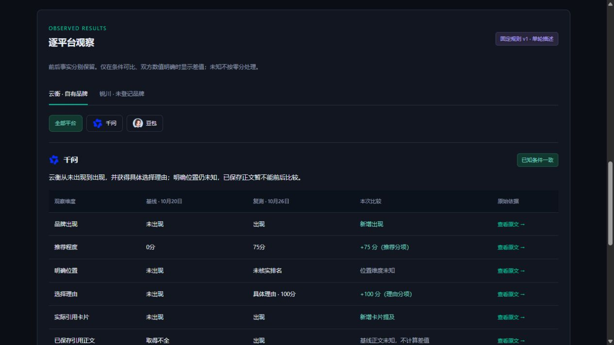

# M01 单轮描述复测：后端与门户合同

本轮实现单轮描述比较的服务逻辑和门户显式代理，没有改正式页面样式。M02发布关联和U04新结果页面仍待完成；不能把接口开发完成视为上线或真实客户效果验收。

## 已实现

- descriptive_v1按稳定品牌目标及冻结的问题/平台第一轮样本配对，支持自有、登记竞品和未登记品牌。原inferential_v1统计门槛独立保留。
- cohort冻结完整规范/hash。基线已确认缺席但没有entityId的登记品牌，可与复测首次出现配对；更换实体需明确等价依据，名称、角色和未确认身份变化不静默通过。
- 逐问题/平台返回出现、推荐、明确位置、理由和三类来源事实，保留原回答/提及/来源索引。仅已知可比值产生observed_delta；未知不补零，明确条件变化优先，无推断区间、改善总分或因果结论。
- 保存结果、直接结果接口、历史和报告统一核对当前有效性，相关变化清空差值且保留原保存记录。冻结缺席基线与当前首次出现复测的身份变化经过额外的原问题/修订/原文归属检查，不被全局配置变化直接抹去。
- 真实MySQL重复读并发重试下，同一方案、采集和结果各只保留一份。门户严格区分模式/目标类型，不接受客户端actor或自定义采样覆盖，不在创建方案时预占采集额度。

## 代码与合同

后端新增descriptive_measurement.py并接入measurement、measurement_history与API；门户新增measurement-request.ts严格合同。调用使用comparisonMode=descriptive_v1、brandTargetIds和可选platforms/promptHashes。第一轮样本由服务端冻结，客户端不能指定。单轮结果在platforms[].observations下，旧推断分布位于platforms[].metrics；两种结构与版本明确区分。

## 验证及边界

- 后端专项56项通过；真实本地MySQL并发检查1项通过，未调用真实设备/模型。
- 门户代理专项43项通过；最终release:check通过：dependencies27.8s、Prisma1.6s、types2.3s、lint13.8s、tests28.7s、build28s。首轮类型检查发现请求类型漏列新模式字段，补齐后最终全量通过。
- 后端最终全量982 passed/2 skipped（含真实本地MySQL），CI范围Ruff/compileall通过；数据库DDL未改，仍为citation_execution_20261026、60张业务表。
- 本地Docker原先停止，已启动原Docker Desktop及原测试容器；没有重置现有数据库。首次全量启动在连接前退出，旧日志不作为本轮通过证据。

正式页面仍是原有推断控件，不能展示新单轮观察单元；U04要接入后才能交付该客户操作路径。本轮无正式页面改动，无真实模型/OSS写入、生产访问、push/PR/部署或网关变更。ContentOS本轮未改。

## 下一阶段局部原型（已确认）

docs/prototypes/citation-measurement-v3/index.html（本地9887）延续已确认v3，展示发布登记与具体交付版本/时间链、一次采集入口/进度、未登记品牌与平台切换、逐项前后事实与未知/不可比、原文抽屉及窄屏卡片。实际浏览器检查默认/待发起/采集受理/部分缺失、发布表单禁用与核对后保存；保存登记进入新方案，不改写旧观察。390×844整页宽375，抽屉宽390、页面390，无横向溢出，视口已恢复。

样例状态仅演示，发布/M02及缺失项补齐仍未对接服务。原型请求用户确认后才接入正式页面；不能把原型的模拟发布/采集当成服务能力。

用户已明确确认“认可，按此实现”，M02/U04继续按此开发；当前提交仅包含M01合同与原型，尚无M02/U04正式实现。
