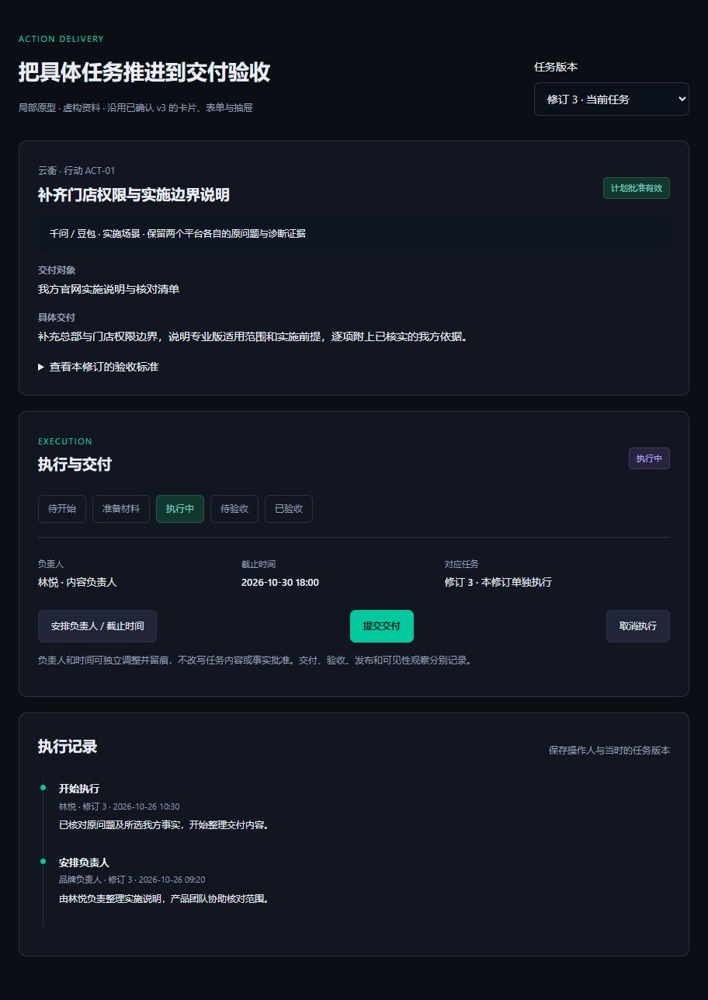
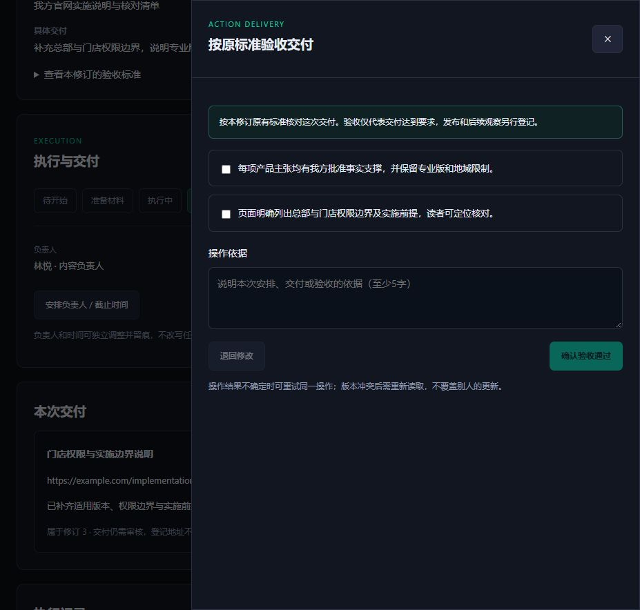

# E03 执行与交付：服务接口与待确认原型

本轮完成后端执行记录、门户可信接口与ContentOS产物来源回执。正式页面组件未改；按用户“页面调整先确认原型”的要求，局部原型等待确认，不能把原型演示视为正式页面完成。

## 局部原型

`docs/prototypes/citation-execution-v3/index.html`，本地http://127.0.0.1:9886/index.html。沿用已确认v3的深色卡片、青色主要按钮、字段及侧边抽屉。增加负责人/截止时间、状态轨道、交付登记、按原标准逐项验收/退回、追加执行记录和历史修订只读。样例数据虚构，无模型、真实授权或发布。

浏览器检查交付→待验收→逐项验收及历史修订：历史负责人、日期、产物和记录独立保存，不显示当前修订产物；未勾完标准或未填依据时禁止验收。窄屏390×844检查pageWidth375<=390，无横向溢出，视口已恢复。按钮/下拉框/勾选具有指针和键盘焦点样式。

## 已实现的服务能力

- 独立执行投影+追加事件，每个行动修订单独保存负责人、期限、交付及验收。准备材料与正式执行分开，后者要求当前计划批准有效。验收标准取自冻结TaskPack，交付/验收不等于发布或可见性改善。
- 门户GET/POST `/api/integration/intelligence/execution`：可信项目范围、当前工作空间可执行成员、历史事件与当前投影读取。姓名与角色来自服务端成员查询，不暴露联系信息。写入签发一分钟、Visibility专用受众授权，绑定请求哈希；不会接受浏览器提供的actor或execution_authority。
- 原操作版本已前移时，由后端确认幂等回执或拒绝CAS，不重复读取外部来源或覆盖新状态。关联内容产物时先查ContentOS可信完成记录，再绑定同一行动修订及原Brief哈希。
- ContentOS GET `/api/evidence-briefs/delivery-receipt`只读返回来源记录，不授权生成/发布、不声称内容质量已合格。历史产物来源验证与当前生成授权分函数处理，不伪装当前时间。审计后端还会核对原授权HMAC及当前计划依赖。
- 新空库schema为citation_execution_20261026，60张业务表；旧数据不自动改造。当前没有生产切换。

## 验证

后端全量948 passed /2 skipped，含真实MySQL并发与签名回执/范围检查；CI范围Ruff、compileall和本地空库/API/worker检查通过。门户专项10、ContentOS回执专项5项通过。

门户完整release:check通过：dependencies35.6s、Prisma1.6s、types2.6s、lint17s、tests31.6s、build27.4s。ContentOS完整release:check通过：dependencies36.3s、Prisma1.4s、types2.7s、lint7s、tests16.2s、build13.5s；仅使用CI专用构建变量，无真实密钥输出。

原型尚待用户确认；正式执行页面、真实任务跨系统交付路径、Q01独立质量和Q02价值闭环尚未验收。未发起真实模型/OSS写入、生产访问、push/PR/部署或网关变更。
