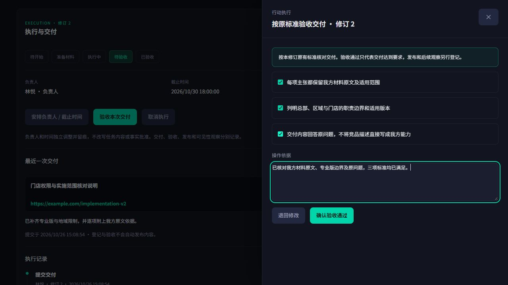
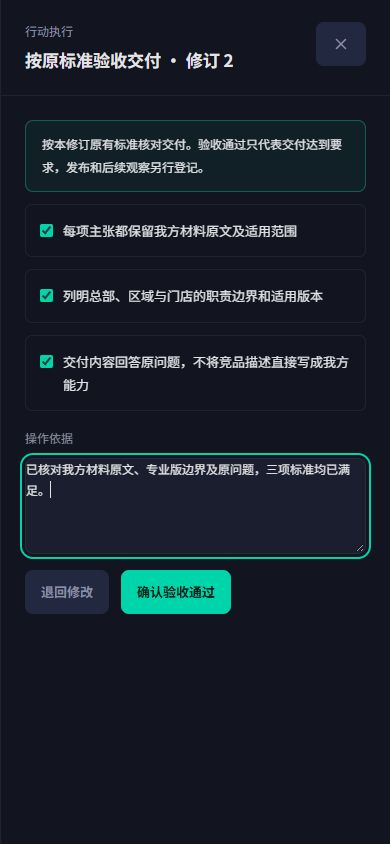
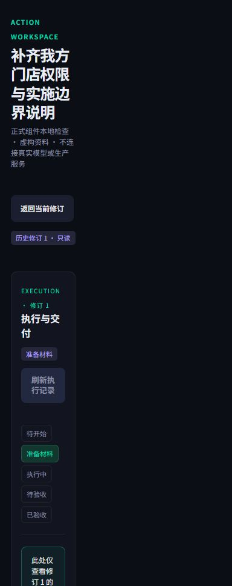

# E03 执行与交付：已确认原型接入正式页面

用户于2026-10-26明确回复“认可，按此实现”。本轮已将执行面板、负责人/截止时间、交付、逐项验收/退回及历史修订只读接入正式任务工作台。服务接口、ContentOS来源回执和页面技术开发已完成；真实鉴权跨服务客户路径和实际价值验收仍单独保留未完成状态，当前未部署。

## 已确认的局部原型

`docs/prototypes/citation-execution-v3/index.html`，本地http://127.0.0.1:9886/index.html。沿用已确认v3的深色卡片、青色主要按钮、字段及侧边抽屉。增加负责人/截止时间、状态轨道、交付登记、按原标准逐项验收/退回、追加执行记录和历史修订只读。样例数据虚构，无模型、真实授权或发布。

浏览器检查交付→待验收→逐项验收及历史修订：历史负责人、日期、产物和记录独立保存，不显示当前修订产物；未勾完标准或未填依据时禁止验收。窄屏390×844检查pageWidth375<=390，无横向溢出，视口已恢复。按钮/下拉框/勾选具有指针和键盘焦点样式。

## 正式组件接入

`TaskExecution`接入当前行动和延迟读取的修订历史；每个项目、行动和修订独立挂载。正式控件沿用已确认v3的深色卡片、状态轨道、青色主按钮、表单与侧边抽屉。执行按钮样式单独限定，避免通用文字链接样式覆盖主要操作；按钮、下拉框、历史展开和勾选有指针及键盘焦点反馈。

- 负责人清单来自当前可信工作空间成员，不默认选人。普通成员只能安排自己或推进自己负责的任务，具名验收由owner/admin/editor进行；查看权限不授予写入权限。
- 开始、交付、验收受当前计划及相关依据复验约束；失效后仍能安排、准备材料或取消，不改写历史执行。历史修订仅展示对应负责人、日期、交付、验收和事件，新修订不继承旧产物。
- 外部地址/核实材料明确标记人工登记；ContentOS草稿和人工任务按实际完成记录核对来源，不能仅凭填写任务编号视为已完成。验收逐项对应冻结标准，未勾完不能通过；退回保留原交付和意见，再交付独立登记。交付、验收、发布、可见性改善分开记录。
- 读时验证行动、修订及投影/历史的版本一致性，完整分页检查连续事件及末页，不静默丢弃旧记录。保存不确定时冻结表单和原请求/幂等键；403/409需关闭后刷新核对。执行写入锁住父工作台的并发计划修改，同时保留原请求重试能力。

正式组件浏览器检查使用本地内存虚构资料，未连接真实模型、内容服务、OSS或生产。实际操作通过交付→退回→再次交付→逐项验收、关闭后的状态、历史修订只读及切回当前修订。390×844下验收抽屉宽390、内部389，页面不超过390；退出抽屉后pageWidth384。浏览器error/warn日志为空，视口已恢复。截图为正式组件检查，不等于正式鉴权全链路验收。

## 已实现的服务能力

- 独立执行投影+追加事件，每个行动修订单独保存负责人、期限、交付及验收。准备材料与正式执行分开，后者要求当前计划批准有效。验收标准取自冻结TaskPack，交付/验收不等于发布或可见性改善。
- 门户GET/POST `/api/integration/intelligence/execution`：可信项目范围、当前工作空间可执行成员、历史事件与当前投影读取。姓名与角色来自服务端成员查询，不暴露联系信息。写入签发一分钟、Visibility专用受众授权，绑定请求哈希；不会接受浏览器提供的actor或execution_authority。
- 原操作版本已前移时，由后端确认幂等回执或拒绝CAS，不重复读取外部来源或覆盖新状态。关联内容产物时先查ContentOS可信完成记录，再绑定同一行动修订及原Brief哈希。
- ContentOS GET `/api/evidence-briefs/delivery-receipt`只读返回来源记录，不授权生成/发布、不声称内容质量已合格。历史产物来源验证与当前生成授权分函数处理，不伪装当前时间。审计后端还会核对原授权HMAC及当前计划依赖。
- 新空库schema为citation_execution_20261026，60张业务表；旧数据不自动改造。当前没有生产切换。

## 验证

最新后端全量949 passed /2 skipped，含真实MySQL并发、签名回执/范围及读时批准有效性检查；CI范围Ruff和compileall通过，沿用前一轮同schema本地空库/API/worker检查。门户本轮专项34项通过，覆盖执行UI、角色/接口、父工作台与原材料路径；ContentOS源代码未变，沿用上一轮回执专项5项及完整门禁。

最终门户完整release:check通过：dependencies30.5s、Prisma1.6s、types2.4s、lint13.9s、tests26.2s、build27s。初轮门禁暴露并修复了测试API参数类型、成员异步读取的effect规则，以及原材料测试在保存锁释放前点击下一步的时序问题；最终源码重新全量通过。ContentOS上一轮完整release:check通过：dependencies36.3s、Prisma1.4s、types2.7s、lint7s、tests16.2s、build13.5s；仅使用CI专用构建变量，无真实密钥输出。

E03/U03按技术实现完成记录，状态保持进行中等待真实鉴权与跨服务客户路径。M01/M02/U04发布资产与单轮观察、Q01独立质量和Q02真实价值闭环继续待完成。本轮未发起真实模型/OSS写入、生产访问、push/PR/部署或网关变更。
