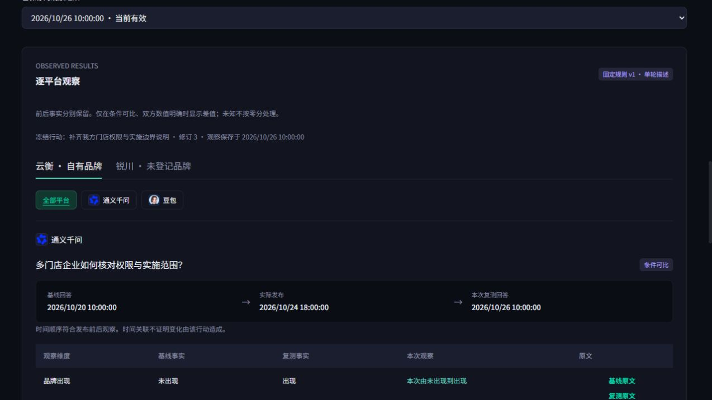
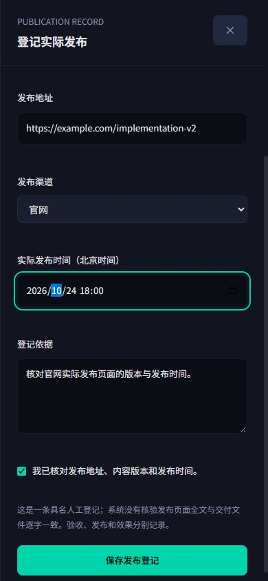

# M02 / U04：发布登记与单次复测正式接入

用户于2026-10-26确认 `citation-measurement-v3`：“认可，按此实现”。本轮按已确认原型完成发布登记、行动修订关联、单按钮一次采集、逐平台进度及逐品牌观察的技术实现。没有上线；真实鉴权、设备和内容服务的完整客户路径及实际建议价值，仍在Q01/Q02中单独验收。

## 客户可用流程

1. 选择项目中的优化行动，读取具体修订和实际交付版本；任务跨分析修订仍可找到。
2. 登记已经发生的发布：选择交付文件、填写发布地址/渠道/北京时间及核对依据，明确勾选确认。保存后进入新观察草稿，已有观察不被改写。
3. 核对当前基线、自有品牌及登记/未登记对比品牌、原任务平台和问题。点击“开始一次复测”，后台先固定范围再发起一次采集；本页显示受理、逐平台完整/等待/缺失数量及分析状态。
4. 部分失败时只补齐失败或不完整回答，保留完整回答，沿用同一审计、问题和独立轮次。最多五批人工补齐；原不完整回答保留。
5. 分析完成后整理并保存观察。按品牌和平台独立核对出现、推荐强度、位置、理由、实际引用卡片、已保存来源正文和检索候选，打开对应分析版本的基线/复测原文与来源。

## 数据与判断边界

- 发布记录具名、签名、追加保存，绑定行动修订、交付事件和产物位置，来源产物原有ContentOS回执一起保留。浏览器不能提供签名、actor、交付凭证或内容哈希来替代后台依据。
- 数据库原 `content_hash` 列在本合同中保存交付记录指纹，API明确返回 `version_fingerprint` 和 `published_bytes_verified:false`。这是人工核对的发布事实，不代表系统取得并核验了发布页面全文，也不授予发布权限。
- 固定观察把行动修订、任务目标、具体发布记录和基线一起写进不可变规范。历史修订可回查，新记录不得写入过期行动版本。修改发布关联、平台或品牌时新建观察。
- 逐问题实际基线采样时间 < 人工登记发布时间 < 实际复测采样时间，才满足发布前后时序。交付的“登记时间”可能晚于实际发布，不能伪装成内容完成时间来否定或认定时序。
- 时序关联与前后回答事实是两层信息。发布未登记、采样时间未知或时间顺序不合格，不会生成发布效果结论；仍保留能核对的原始回答事实。单轮变化不等于稳定效果、改善总分或行动因果。
- 条件待确认、不可比、缺失和未知分别呈现；双方已知且可比才输出差值。已有更新的分析/配置后，读取投影移除失效差值，不修改已保存原记录。
- 修复了任务原问题校验把旧回答的JSON哈希口径强加给capture-v2原始UTF-8哈希的问题：按冻结响应来源核对正确口径、原文及哈希，真实采集任务不再被误拒绝。
- 本轮没有DDL变更，仍使用 `citation_execution_20261026`、60张业务表；没有迁移历史测试数据。

## 权限、重试与页面

门户显式白名单转发新合同，使用可信项目和角色；发布/重试均不能借用其他项目。只读用户无写入控件。发布关联要求当前可用的已交付或已验收版本，普通成员仅能登记自己负责的执行。过期签名、伪造交付、错误修订及索引均拒绝。

采集发起沿用原持久额度账本；补齐既有复测不另预留一次审计额度。固定范围成功但采集受理回执丢失时，保留采集原请求/原键重试，不再新建范围或审计。服务不确定时锁住编辑及本页分析版本切换；403/409要求刷新当前权限/版本。发布不确定也固定原表单与请求。数据列表完整读取游标；最近50次采集与10份观察的显示边界明确提示，不汇总未展示记录。

正式页面替代原来的旧发布表单和多轮发起入口，保留既有历史推断结果阅读器并新增单轮结果分支。样式沿用确认的深色卡片、青色主按钮、品牌Tab、平台图标、层级和阅读抽屉。主要按钮有独立限定样式，防止被通用文字按钮规则覆盖；可点击控件具有鼠标和焦点反馈。

## 验证

- 门户专项55项通过：权限/代理、单次发起、两阶段回执丢失的同键重试、未登记品牌、发布版本与北京时间、新草稿/历史不变、缺失/过期差值等。
- 后端全量996 passed /2 skipped，包含真实隔离MySQL旧快照下同发布操作只存一次、同补齐操作只增加一批attempt，完整回答保持原selected response及独立轮次为零增量。CI范围Ruff、compileall通过。
- 门户最终源检查：依赖、Prisma、类型、lint和完整测试通过；生产构建结果见末尾追加记录。ContentOS源码未修改，沿用E03回执合同和已通过的门禁。
- 浏览器使用正式组件和本地内存虚构数据，已实际检查发布版本选择/保存→新草稿、单按钮发起→等待/部分完成→保存观察、品牌/平台切换、原文抽屉。390×844下页面宽384、抽屉390；浏览器error/warn为空，视口已恢复。平台图标复用现有资源。
- 没有调用真实模型、生产、OSS或设备，没有push/PR/部署或网关变更。浏览器检查不替代真实鉴权跨服务验收。

最终门户检查记录：release:check的dependencies28.6s、Prisma1.6s、types3s、lint15.1s、tests26.6s通过；build阶段6.6s提前退出且没有给出诊断。源码保持不变，以相同4096MB Node设置单独重跑`npm run build`，退出码0，生成完整生产路由。复用已成功的五项门禁，未再次安装依赖或重复全套测试。该记录说明本地源检查结果，不等于GitHub CI或发布成功。
