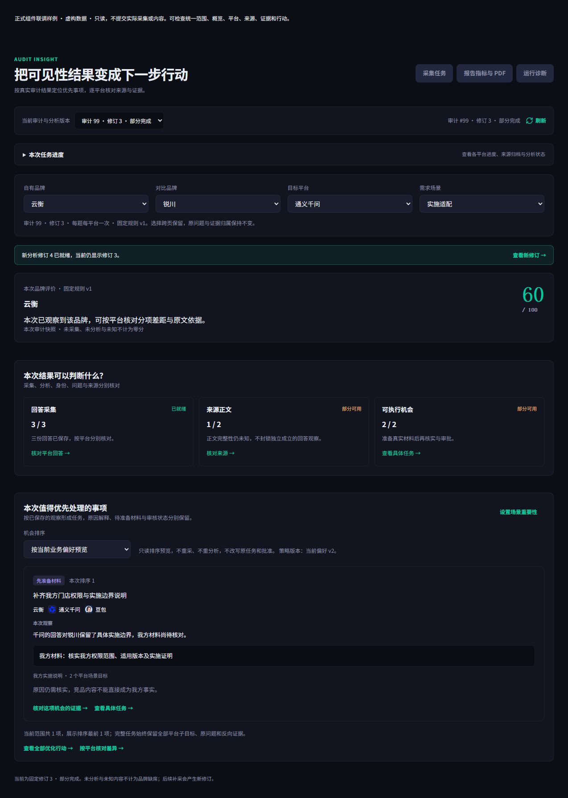
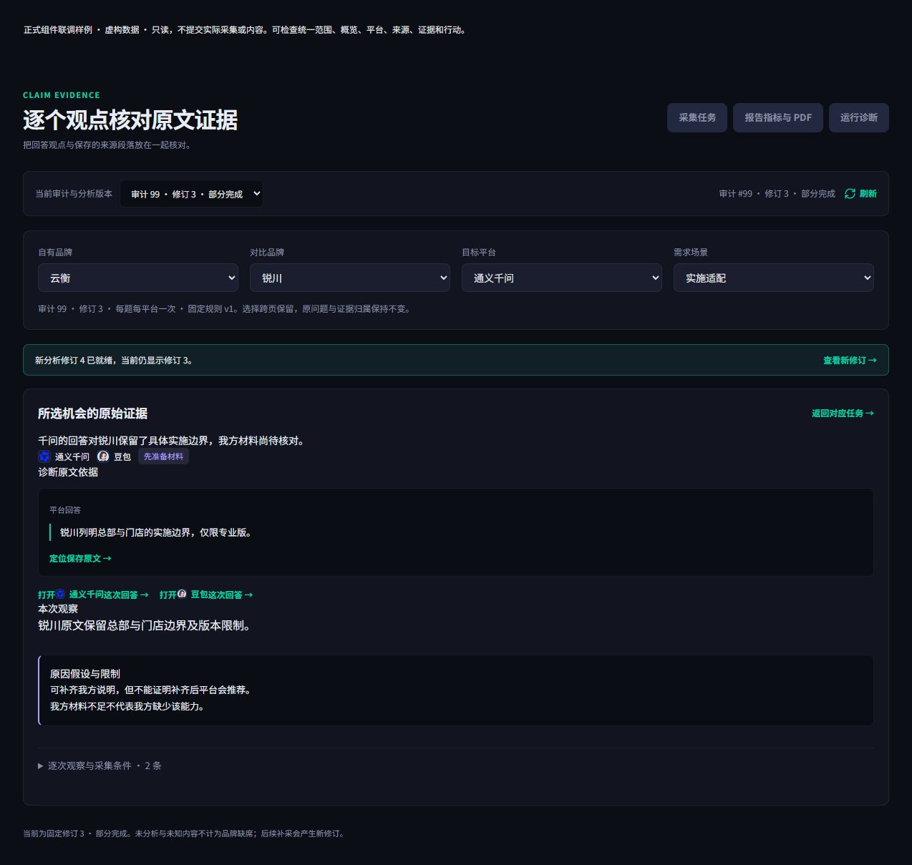
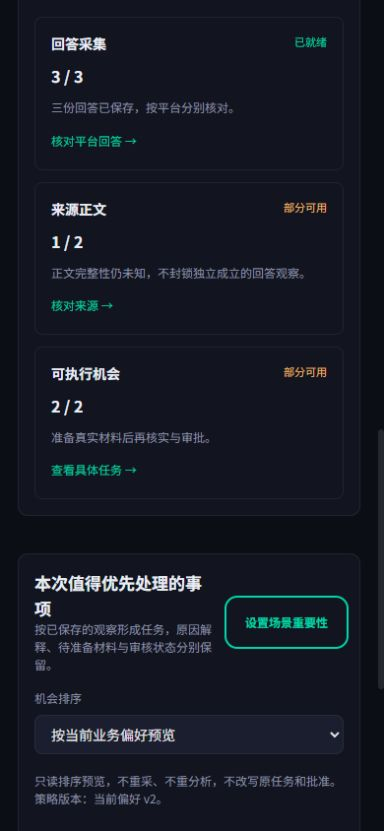
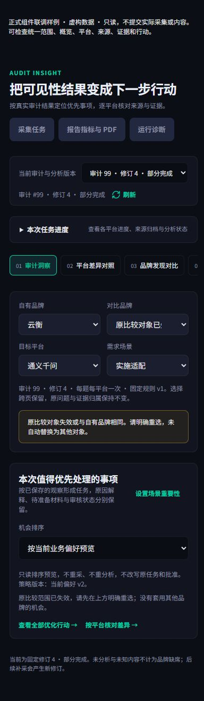

# U01/U02 统一比较范围与概览入口（2026-10-25）

本轮按已确认 v3 的 scope、overviewV3、opportunityCards 和平台/证据流接入正式组件。复用四项比较控件、现有任务卡片、材料状态块、平台图标与原文阅读器。未改原型、后端、网关、数据库或发布流程。

## 已接入

- 自有/对比品牌、平台、场景以 URL 为共同来源，跨页与刷新保留；仅在首次且唯一确认自有品牌时初始化，不随结果变化静默改品牌。未登记主体可选择，失效对象保留原值并明确提示，不替换为第一个竞品。
- Run 以 URL 为优先依据，浏览器返回或直接改变 URL 时不会继续显示旧版本。手动切换修订保留四项范围和排序，清除旧机会/行动选择，等待该 Run 真正加载后再呈现结果。对旧异步响应与返回 ID 不符加保护。采集已发布回调按结果去重，不会因切换范围或返回概览重放同一发布、清掉原机会。
- 评分结论、分项、图表和评分依据使用所选平台/场景；缺少对应范围数据不退回全审计分数。没有所选比较对象时不画默认竞品。身份发现列表与材料资产等全审计/工作空间记录明确标记范围，原始来源/观点保留所选平台和场景的全部材料，不按品牌是否出现删去中性证据。正式内容/复测记录仍按各自冻结版本展示，不把全局选择冒充对旧合同的重新绑定。
- 概览与行动页共用完整机会读取器，校验分页版本、策略、总数、连续偏移、重复记录及权限。完整读完再呈现排序和过滤结果。平台、场景与比较对象须在同一子观察中匹配，不把跨观察条件拼成假机会。支持冻结与当前偏好只读排序，跨页保持；不重采、重分析或改旧任务/批准。
- 概览展示当前范围前三项及总数，可进入全部机会、对应具体任务或该项原始证据。保留准备材料、未知、延后及不适用状态。卡片将观察、材料需求、交付对象和动作分层，不显示收益或推荐提升承诺。
- 所选机会证据显示自己的诊断原文、反证/假设、所有平台子观察与原回答入口；用原 Run/owner/segment 和 Unicode 范围定位。缺失 ID 不改用第一条。范围切换后不重写旧引文，显式提示并允许返回可确定的原范围。回到行动页仍选中原机会，不混入无关行动。
- 平台页只把原始回答视为同题观察，品牌方向来自下方按范围匹配的 A05 机会，不复用旧通用诊断。当前平台缺少该问题回答时不补用其他平台。来源页共用顶部平台选择，不再有第二套平台控件；只有其他平台的来源时提示筛选无匹配，不误称整次审计没有来源。

## 验证

最终完整 npm run release:check 全通过：dependencies48.3s、Prisma1.6s、types2.5s、lint13.5s、全量tests25s、Nextbuild31.4s。日志 E:/workspace/.citation-value-preview/scope-release-complete.log。首次检查发现一个新测试 fetch mock 的过窄参数类型，修正后通过；随后按 v3 补齐机会卡片边框与材料分区，又对最终源码完整运行一次并通过。以上最终通过记录对应本次提交源码。

专项55项通过：新范围5、根页面6、概览/读取器8，及已有任务12、来源12、评分6、原型视图6。覆盖相同子观察匹配、完整分页/策略变化、未知/延后、精确 ID 深链、跨页与 URL/返回导航、原文定位、失效对象、新修订清除旧任务、过期异步结果、发布去重和只读请求。根页测试使用导航适配器；没有把客户端仿真当作真实服务验收。

浏览器加载正式 intelligence 页面组件与虚构只读数据，导航采用本地适配器，确认概览→原机会证据→原任务、Unicode 高亮、四项范围/排序刷新后保留、修改修订后的失效对象、来源页共用平台控件。桌面正常视口及真实390×844移动端均检查，页面宽度不超过视口；移动端 client/scroll384/384，失效提示状态scroll390<=inner390。按钮/下拉框cursor为pointer，沿用现有键盘焦点；行动页只有四个顶部范围控件，没有重复行动范围。视口已恢复。最终浏览器错误日志为空。

## 边界

U01/U02 的本轮页面开发完成，正式鉴权项目、真实 API/worker/模型和身份→新修订→交付完整路径仍在 Q02 统一验收，任务保留进行中与技术完成标记。E02/E03 的事实资格、Brief v3/ContentOS、执行责任与交付，M01/M02/U04 的发布后观察仍未完成。Q01 独立语义/任务价值和 Q02 真实客户闭环未通过。后端沿用此前925passed/2skipped记录，本轮没有重跑未改的后端。

只读样例不能证明语义正确、内容提升效果或正式 Next/鉴权/后台服务全链路。本轮无 push/PR/部署、生产访问、真实模型请求或真实 OSS 写入。来源、内容与复测保持各自证据角色，不把全审计身份/材料列表假标为当前竞争范围的执行结果。
