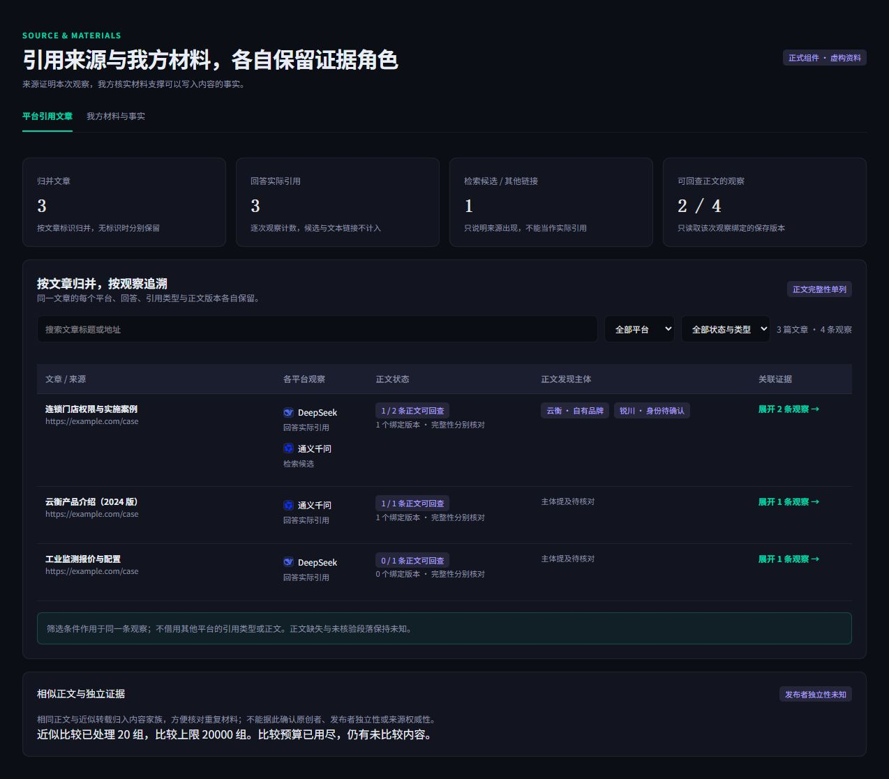
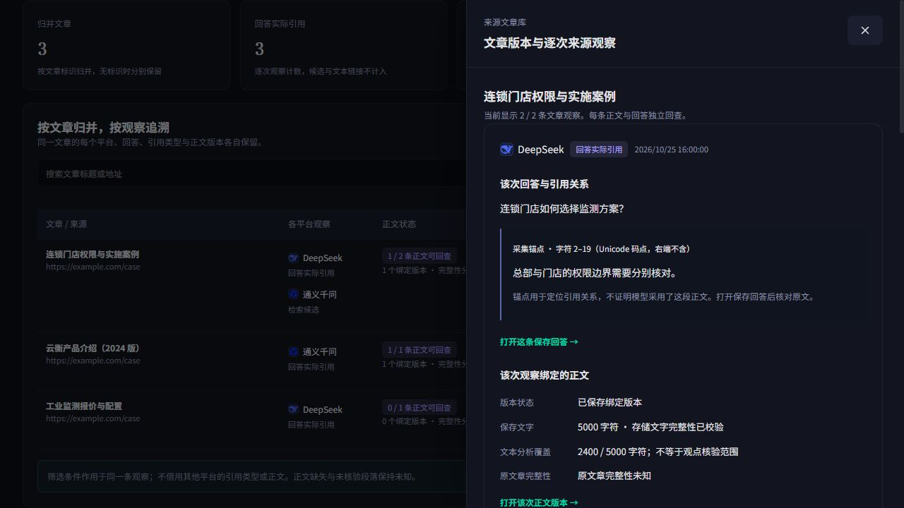
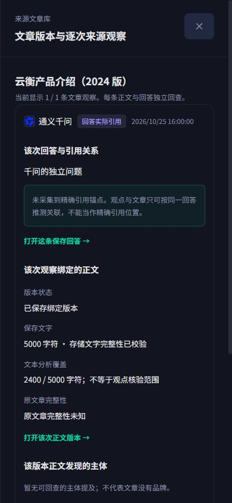

# U02 来源逐次观察接入验证（2026-10-25）

本轮按已确认的 citation-intelligence-v3 `sourcesV3/sourceDrawer` 接入正式来源文章表格与观察抽屉，没有新增布局方案。范围为门户 U02 的 A04 来源观察子流程，未更改后端、网关、数据库、发布配置或生产数据。

## 实际行为

- 读取现有受项目权限保护的 `tasks?op=sourceObservations`，逐页校验 source-observations-v2、总数、连续偏移、重复观察和比较覆盖/读取权限一致性；完整读取后才呈现汇总。加载、失败、未发布、已发布但无观察分别显示。GET 不启动任务、不占模型或采集配额。
- 按 document_id 归并文章；缺少文章标识的观察分别保留，不按相似标题或相同地址强行合并。平台、状态/类型与搜索在同一条观察上联合筛选，然后归并，避免把另一个平台的正文或实际引用标签借过来。
- 每条观察分别保留平台图标、原问题、时间、实际引用/检索候选/文本链接、采集锚点或同回答推测关联、冻结 Run/回答/正文版本标识。打开原回答或正文时显式传递对应 Run；版本校验未通过时暂停正文入口，不替换成其他观察的版本。
- 正文保存完整性、原文章完整性、文本分析字符覆盖、观点核验候选/已检查/延后/无效和未核验 Unicode 范围分开。逐观点呈现主体/范围/时间/数字/限定条件、反向或冲突线索与人工复核，不把无结果当作没有支持，也不声称模型实际使用了该段。
- 核验摘录调用共享保存原文阅读器，以原 Run/snapshot/segment 和 Unicode 码点核对后高亮；不相符时保留冻结摘录并提示版本问题，不显示伪定位。来源阅读器改为明确的核验文案，原任务阅读行为保留。
- 保存正文中的自有、竞品及未登记主体单列；不计作平台回答提及或推荐，不借给无正文平台。同正文与近似转载家族显示比较覆盖、成员与其他文章入口，发布者独立性/原创归属保持未知，不作为权威评分。
- 原始来源卡片摘要与正文角色区分。补采复用现有幂等入口，仅对有写入权限者展示，离开模态后由原采集反馈处理；不会改写本次冻结观察。材料页签和原行动返回入口保留。

## 验证证据

门户最终完整 `npm run release:check` 通过：dependencies 29.5s、Prisma 1.6s、types 2.2s、lint 13.3s、全部 tests 24.3s、Next.js build 28.2s。日志在本地工作资料 `E:/workspace/.citation-value-preview/sources-release-verified.log`。在首次完整通过后发现移动端表格撑宽，修复 CSS，再对最终源码完整运行并通过；未复用修复前的通过结果。

专项 36 项通过（来源 12 项、现有任务 12 项、任务代理 6 项、原型视图 6 项），覆盖同文章不同平台/版本、实际引用与候选、同观察筛选、未知正文、精确 Unicode 原文、冻结版本不符、跨引用隔离、所有品牌、转载家族跳转、分页变化/重复、未发布/失败重试、只读权限、人审和旧请求取消。没有新增无意义的样式快照测试。

实际正式组件用虚构资料在本地浏览器检查：文章表格、逐次抽屉、千问读取其自己的 `555...` 版本及 Run、核验原文高亮、默认及390×844视口。表格窄屏宽940px只在314px容器内横向滚动，页面 client/scroll 为384/384（innerWidth390）；模态 scroll390不超过innerWidth390。检查后恢复默认 viewport。按钮、下拉框和页签均显示 pointer，复用键盘焦点样式。

本地临时浏览器脚手架初次缺少 Next 环境 shim 导致 process undefined，已修正只影响样例打包的 shim；其后正式组件可读可交互，未出现新渲染错误。脚手架只允许内存虚构请求，拒绝外部请求，不能当作后端全链路联调。

## 边界与剩余事项

U02 保持进行中：概览到完整机会/任务的深链、跨页统一自有/比较/平台/场景上下文仍未完成。U03/E02/E03 的合资格新事实、Brief v3/ContentOS 和执行交付，以及 M01/M02/U04 的发布后观察仍待继续。Q01 独立语义/任务价值与 Q02 真实客户链路仍未验收。

当前网关未新增精确锚点采集能力；无锚点诚实显示同回答推测关联。本轮真实模型调用、生产访问、真实 OSS 写入、PR/push/部署均为零。现有后端未改动，保留此前925 passed/2 skipped证据。本地组件检查不能证明语义判断质量、来源原创性或品牌提升因果。
