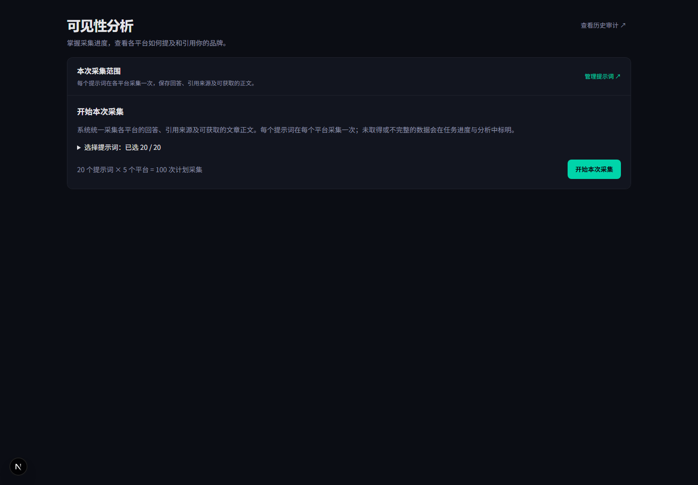
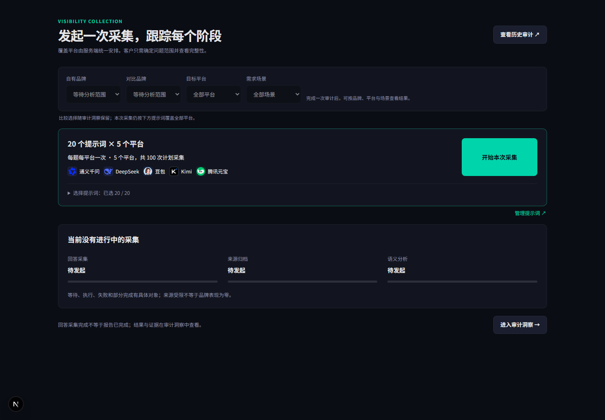

# 可见性分析页：已确认 v3 原型对齐

日期：2026-11-01，Asia/Shanghai。分支：`codex/visibility-prototype-parity`，基于 `87c3767`。本地完成，未推送、未部署。

## 基准与结论

用户于 2026-10-24 确认的 `citation-intelligence-v3/README.md` 与 `value.js` 的 `captureV3()` 为基准。原始 v3 文件保留在 `E:/workspace/genilink-platform/docs/prototypes/citation-intelligence-v3`，没有修改。

基准截图已存入本仓库：[已确认原型](images/visibility-prototype-parity-20261101/approved-v3.png)，SHA256：`a05f7b210f721c75c34dc3870953d22a7bcd25313f52ba8162df17f4e0d63e93`。

原实现只呈现通用采集配置卡和任务详情，缺少 v3 的统一比较范围、突出显示的单次采集主卡片、空闲三阶段及相应信息层级。此次修复还原这一结构，使用现有主题 token 和真实业务接口，保留必要的权限、失败和未知状态。

## 差异与修复

| 项目 | 原实现 | 处理 | 验证 |
| --- | --- | --- | --- |
| 页首与结构 | 通用“可见性分析”标题，配置说明占据首屏 | 改为“发起一次采集，跟踪每个阶段”，采用与审计洞察一致的页首；比较范围→采集主卡→阶段状态 | 已验证 |
| 统一比较范围 | 采集页没有四项控件 | 复用 AnalysisScopeBar，按实际 Run 提供自有品牌、对比品牌、目标平台和需求场景；进入洞察／证据时保留选择 | 已验证 |
| 单次采集主操作 | 小按钮放在配置卡底部，平台范围靠文字说明 | 数量与五个平台标识集中呈现，桌面右侧大主按钮、手机全宽；保留提示词选择与管理入口 | 已验证 |
| 阶段与空闲状态 | 无审计时没有阶段面板；有任务时以总体进度与详情为主 | 始终呈现回答采集、来源归档、语义分析；分别计数／显示进度，未知不伪造比例，失败不沿用旧修订的绿色分析进度 | 已验证 |

必要的生产调整：原型中的演示状态按钮不进入产品；无分析版本时比较控件禁用并说明原因；比较选择用于结果查看，不改变服务端覆盖全部平台的采集策略。提示词选择、操作幂等、进行中禁用、防重复提交及状态查询恢复逻辑保留。

范围详情请求在独立组件中异步读取，不阻塞提示词配置和任务进度；选择筛选项不重新读取详情，不发起采集或模型分析。拒绝审计／Run 不匹配的响应。未对原型示例数值作业务数据回填。

## 截图

截图由真实 Next.js 16.2.6 页面组件、ProjectProvider 和 Chromium 生成；接口使用本地固定测试样本，未登录生产、创建任务或调用模型。应用外层导航未纳入截图，不把局部预览视作生产环境完整验收。

| 修复前 | 修复后 |
| --- | --- |
|  |  |

[手机采集中](images/visibility-prototype-parity-20261101/after-running-mobile.png) · [手机分析失败](images/visibility-prototype-parity-20261101/after-failed-mobile.png) · [浅色主题](images/visibility-prototype-parity-20261101/after-idle-desktop-light.png)

## 检查结果

- 全量测试：172 个文件通过，2 个文件跳过；877 项通过，2 项跳过。全量之后的失败进度／证据入口调整以 26 项相关回归测试再次验证，全部通过。
- 新增 `visibility-prototype-parity.test.tsx`：空闲三阶段、不自动采集、比较范围保留、跨审计响应拒绝、失败时不显示旧字符覆盖。
- TypeScript、改动文件 ESLint、`git diff --check` 通过。
- 浏览器覆盖无任务、采集中、部分结果、分析失败，1440×1000 和 390×844，深／浅主题，共 16 张修复后截图。无页面异常、横向溢出和非 GET 请求。
- 原型符合度人工评估：5/10 → 8/10；视觉模板感检查：9/10 → 9/10（越高越好）。评分为人工检查，不是自动像素比较；未运行设计检测器。
- 四项差异均完成，无推迟项。正式应用外层导航、线上真实数据状态及部署后视觉验收尚未执行；本次未修改外层导航、后端、网关或发布流程。

本地浏览器复核脚本及其余截图位于 `.tmp-visibility-preview/`（不入库）。此前性能与下拉修复仍保留在 `.analysis-fix-portal`／`.analysis-fix-backend`；本分支包含相同的 Next history 通知修复，后续合并时保留一次即可。
